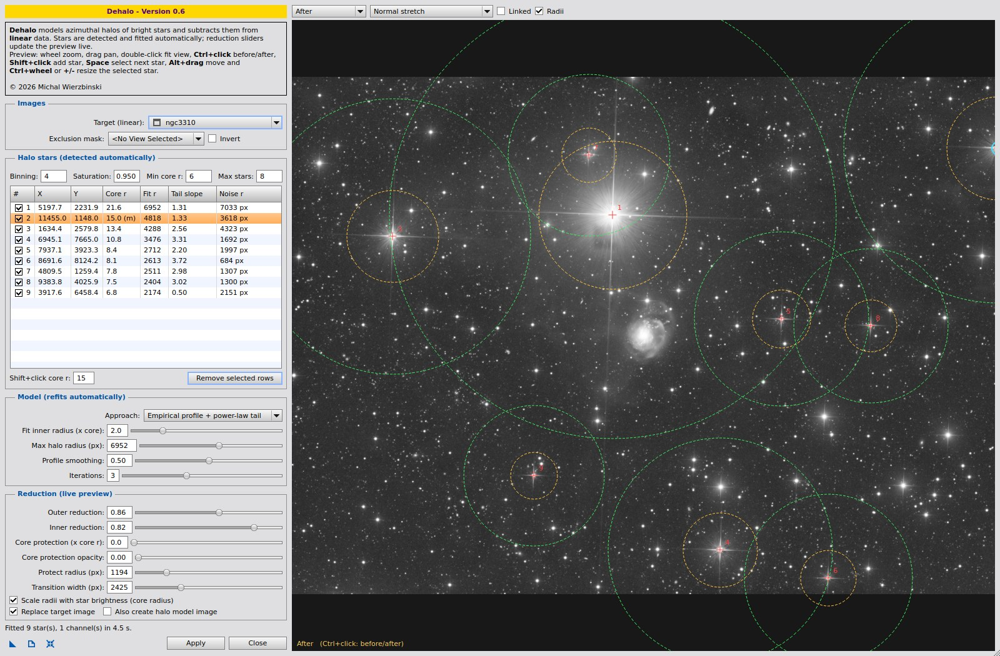

# Dialog reference

This page describes every control of the Dehalo dialog, with the default value and when to change it.

## Images

**Target (linear)**
:   The image to process: a grayscale or an RGB image. Each channel of an RGB image gets its own model. When you
    start the script, the active image is the target.

**Exclusion mask**
:   Optional. Pixels where the mask is above 0.5 are not used for the fit. Use it for a galaxy, tidal tails, stellar
    streams, IFN or a nebula inside a halo, so that their light does not go into the halo model. The mask is used only
    for the fit; the model is subtracted from all pixels. Examples: [NGC 3077](examples/ngc-3077.md),
    [Arp 273](examples/arp-273.md), [Sh2-82](examples/sh2-82.md).

**Invert**
:   Use it for a protection mask, where the structure is black. The script refuses a mask that excludes more than 80%
    of the image, because this is usually an inverted mask.

## Halo stars

**Binning** (default 4)
:   Binning factor for the fit and the preview. The result is always calculated at full resolution. Use 2 for small
    images (less than about 5000 px wide), so that the profiles have enough points near the star. Example:
    [NGC 3077](examples/ngc-3077.md).

**Saturation** (default 0.95)
:   Pixels at or above this value make a saturated core. Many masters saturate below 1.0, because integration scales
    the frames. Read the value at the centre of a bright star (move the cursor over the star in PixInsight) and set
    the Saturation a little below it. Example: [M99](examples/m99.md), where the cores are at 0.60 to 0.65.

**Min core r** (default 6)
:   The smallest saturated core radius (px) that counts as a halo star. Lower it if a halo star is missing. RGB
    masters usually saturate less than L.

**Max stars** (default 8)
:   The largest number of detected stars, largest cores first.

**Star table**
:   One row for each star: number, position, core radius, fit radius, tail slope and noise radius (where the profile
    goes into the noise). *(m)* marks a star that you added, *(e)* a detected star that you moved or resized.

    - **Untick** a star to keep its halo in the image. The star stays in the fit, so the models of the other stars
      still take its light into account.
    - **Remove selected rows** removes false detections and wrong manual stars from the model. Select rows with
      click, ++ctrl++ + click or ++shift++ + click.

**Shift+click core r** (default 10)
:   The core radius given to a star that you add with ++shift++ + click in the preview. It sets the size scale of the
    star's model and radii.

## Model

These settings start a new fit after a short pause.

**Approach**
:   - *Empirical profile + power-law tail* (default): the measured profile, smoothed. It follows rings and bumps
      of the halo. Beyond the radius where the profile goes into the noise, the model continues as a power law.
    - *Smooth power law (outskirts)*: one power-law curve fitted on the outskirts. It is never above the measured
      profile. It is the smoothest model and it removes less near the star.

**Fit inner radius (x core)** (default 2.0)
:   The profile is measured from this multiple of the core radius. Pixels nearer to the star are saturated or not
    linear.

**Max halo radius (px)** (default 5000)
:   The halo radius of the brightest detected star. The radius of the other stars is scaled by their core radius.
    Beyond this radius the model decreases to zero over a further 50%. Increase it for a very bright star whose halo
    covers the field ([NGC 3310](examples/ngc-3310.md), [RCW 85](examples/rcw-85.md)); decrease it in a dense star
    field ([Arp 273](examples/arp-273.md)).

**Profile smoothing** (default 0.50)
:   Width of the smoothing window of the profile. Higher values give a smoother model.

**Iterations** (default 3)
:   Number of joint fit iterations of all stars and the sky plane. More iterations separate overlapping halos better.

## Reduction

These settings do not start a new fit. The preview changes immediately.

**Outer reduction** (default 1.00)
:   The part of the halo that is removed far from the star. 1 removes all of the model. Values up to 1.5 remove
    more than the model, if the model is too low; use them with care.

**Inner reduction** (default 0.30)
:   The part of the halo that is removed near the star. Low values keep more of the natural glow; high values
    (0.7 to 0.85) remove the bright inner halo, for example around HD 92095 in [NGC 3310](examples/ngc-3310.md).

**Core protection (x core r)** (default 0, off)
:   No subtraction inside this multiple of the core radius. The reduction increases smoothly to the full value at
    twice this radius. It keeps the star core and its edge as in the original image. Works together with the opacity.

**Core protection opacity** (default 0, off)
:   How much of the core zone is protected. 1: nothing is subtracted inside the zone. Values from 0.3 to 0.7 give a
    weaker glow that fades out. Start with low values: a large protected zone leaves a bright glow around small stars.

**Protect radius (px)** and **Transition width (px)** (defaults 600 and 1500)
:   The reduction changes smoothly from the inner value to the outer value between *protect* and
    *protect + transition*. The values are for the brightest detected star. In the preview, the yellow circle is the
    protect radius and the green circle is where the full outer reduction starts. A small protect radius removes
    more of the bright halo near the star.

**Scale radii with star brightness** (default on)
:   Scales the protect radius and the transition width of each star with its core radius. The extent of the halo
    is approximately proportional to the core radius.

## Apply options

**Replace target image** (default on)
:   Apply writes the result into the target. The target gets one **Dehalo** entry in its history, and Undo restores
    the original image. Negative values are set to 0. After the replace, the script reads the target again and makes
    a new fit: a second Apply removes only the halo that is left.

    When this option is off, Apply makes a new image `<id>_dehalo` with the FITS keywords and the astrometric solution
    of the target.

**Also create halo model image**
:   Apply also makes `<id>_halomodel`: the part of the halo that was subtracted.

## Preview

The view list selects **After**, **Before** or **Removed halo**. The stretch list selects a normal or a **hard
stretch** (to see faint halo and IFN). **Linked** stretches all colour channels together (see
[Preparing images](preparing-images.md#linked-and-unlinked-preview-stretch)). **Radii** shows or hides the circles.

| Action | Result |
|---|---|
| Mouse wheel | Zoom, up to 8&times;. Zoom out below the fitted view to get space around the image. |
| Drag | Pan. |
| Double-click | Fit the image in the preview. |
| ++ctrl++ + click | Switch between Before and After. |
| ++shift++ + click | Add a halo star at this position. The new star is selected. |
| ++space++, ++shift+space++ | Select the next or the previous star (cyan circle). |
| ++alt++ + drag | Move the selected star. It can also be outside the image. |
| ++plus++ / ++minus++ | Make the core radius of the selected star 2% larger or smaller. Hold the key for a continuous change. |
| ++ctrl++ + wheel | The same, 5% for each wheel step. |

The keys work when the mouse is over the preview. A detected star that you move or resize becomes an edited star
*(e)*. When the stars are detected again, edited and manual stars stay, and detection does not add a star near the
detected position of an edited star.

### Stars outside the frame

A star just outside the frame can have a halo that reaches into the image. Zoom out below the fitted view, then
++shift++ + click at the star's position outside the image, or ++alt++ + drag a star there. Set its core radius
(++plus++ / ++minus++) so that the model has the size of the halo. Only the pixels in the image are used for its
profile.

## Buttons

**New Instance** (triangle, bottom left)
:   Drag it to the workspace to make a process icon with the current parameters and stars, or onto an image to run
    Dehalo there without the dialog. Double-click the icon to open the dialog with these parameters.

**Documentation** (page icon)
:   Opens the reference page with the theory and the formulas (see
    [Installation](../installation.md#3-install-the-documentation-optional)).

**Reset**
:   Sets all parameters to their default values and detects the stars again. Manual stars are removed.

## History and replay

Each Apply with **Replace target image** adds one Dehalo entry to the image history, with all parameters: the
dialog settings, the star list (position, core radius, ticked or not), the exclusion mask and the options. The
History Explorer shows them.

- Drag the entry onto another image to run Dehalo there with the same parameters and stars, without the dialog.
  For example, process the L master, then drag the entry onto the R, G and B masters of the same field.
- Drag the entry to the workspace to make a process icon.
- The exclusion mask must be open with the same identifier when you replay a run that used a mask.
