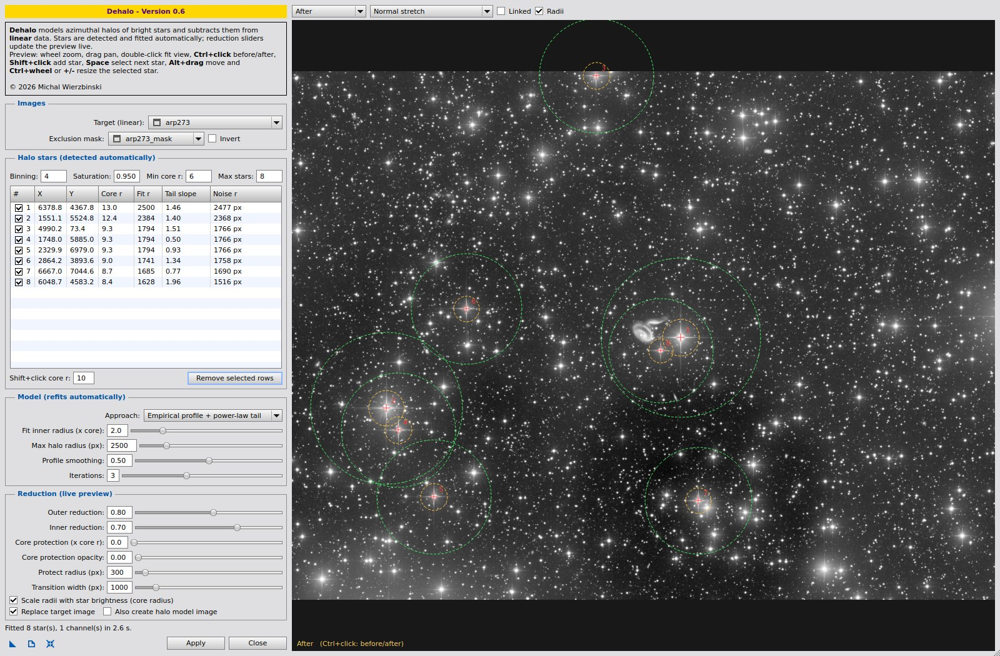
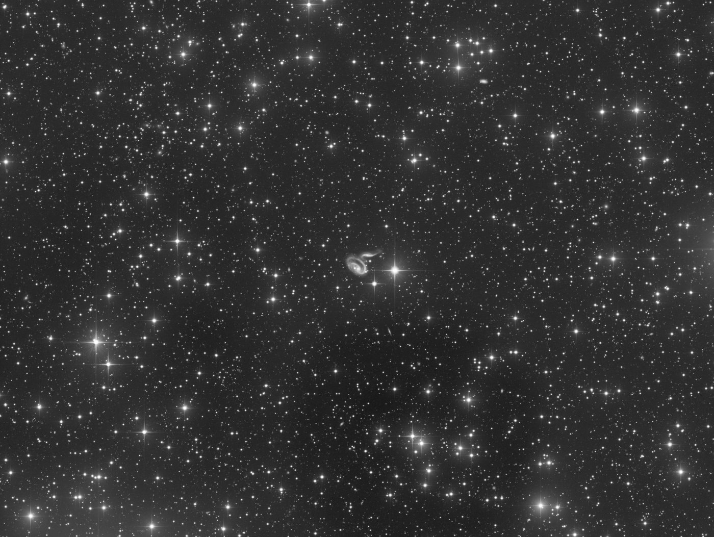
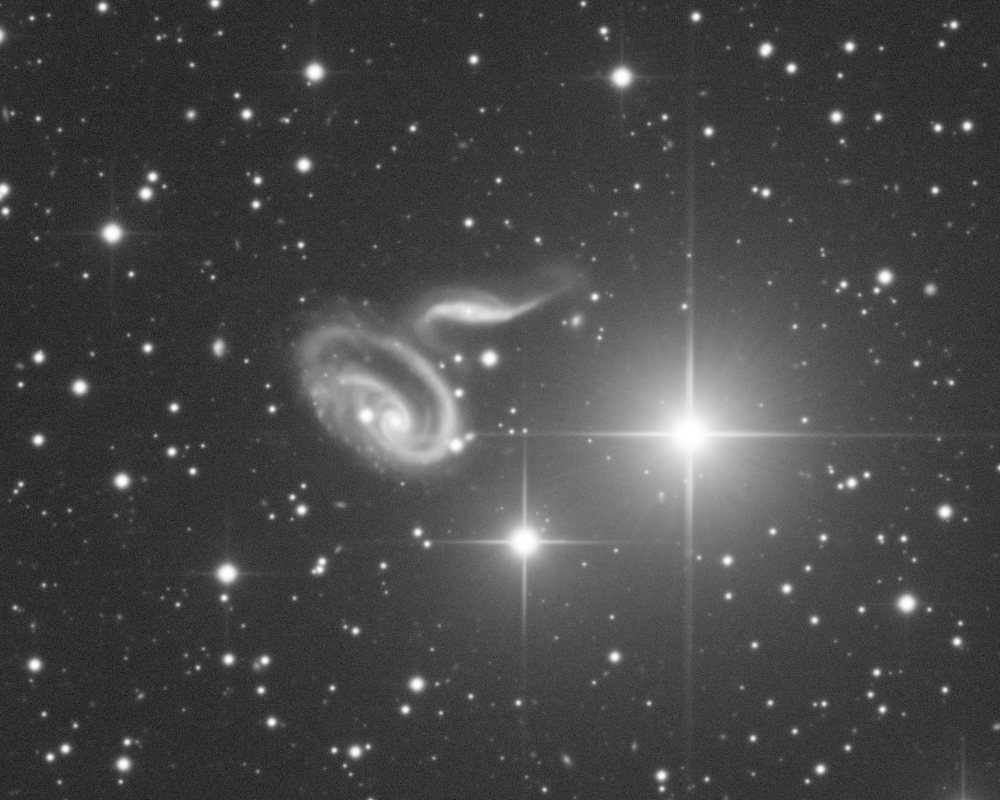
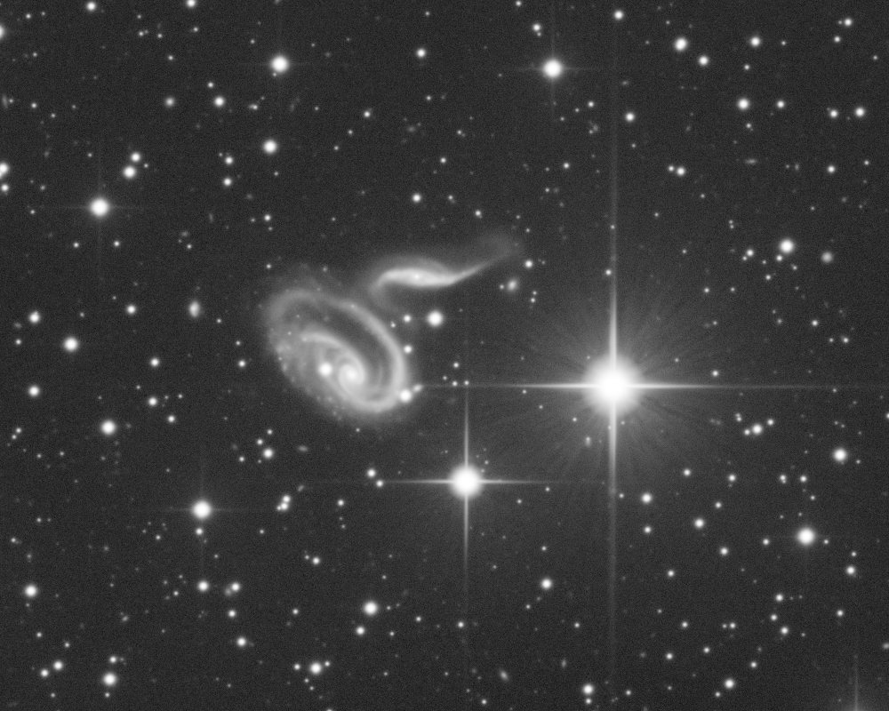
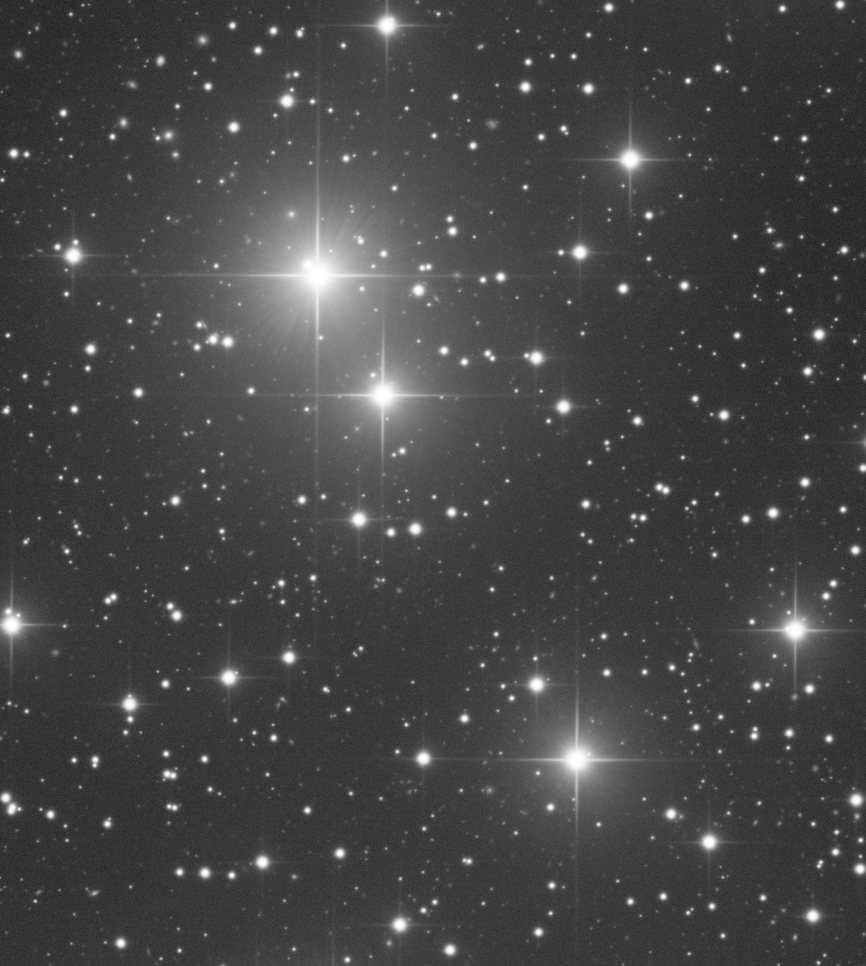

# Arp 273: dense star field next to a galaxy pair

| | |
|---|---|
| Data | Dark Matters Astro |
| Telescope / camera | PlaneWave CDK14, Moravian C5A-100M |
| Image | Luminance master, 11542 &times; 8676 px, 0.31"/px |
| Preparation | GradientCorrection (default parameters) |

Arp 273 is in a dense star field in Andromeda. The brightest star of the field is next to the galaxy pair.

## Problem with the default settings

With the default settings, the preview shows **dark areas** around the group of bright stars on the left. The halos
of these stars overlap, and in a dense field the outskirts of each profile contain the light of many faint stars. A
model that extends to 5000 px with full outer reduction removes too much there.

Changes:

| Problem | Change |
|---|---|
| Over-subtraction far from the stars. | **Max halo radius 2500 px**, **Outer reduction 0.80** |
| The bright inner halo stays. | **Inner reduction 0.70**, **Protect radius 300 px**, **Transition 1000 px** |
| The galaxy pair is inside the rings of star 1. | Exclusion mask on the galaxies |

## Exclusion mask

Make the mask with PixelMath as in [NGC 3077](ngc-3077.md#exclusion-mask-for-the-galaxy), with this expression (an
ellipse around the galaxy pair, semi-axes 650 &times; 380 px):

```
iif(((x()-5840)/650)^2+((y()-4240)/380)^2<1,1,0)
```

## Settings

| Group | Setting | Value |
|---|---|---|
| Images | Exclusion mask | **galaxy pair ellipse** |
| Halo stars | Binning / Saturation / Min core r / Max stars | 4 / 0.95 / 6 / 8 |
| Model | Approach / Fit inner radius / Max halo radius | Empirical / 2.0 / **2500 px** |
| Model | Profile smoothing / Iterations | 0.50 / 3 |
| Reduction | Outer / Inner reduction | **0.80** / **0.70** |
| Reduction | Protect radius / Transition width | **300 px** / **1000 px** |
| Reduction | Scale radii with star brightness | on |



## Result


  
  
</img-comparison-slider>
<div class="cmp-labels"><span>Before</span><span>After</span></div>

The galaxy pair and star 1 (2000 &times; 1600 px crop):


  
  
</img-comparison-slider>
<div class="cmp-labels"><span>Before</span><span>After</span></div>

The group of bright stars on the left (2600 &times; 2900 px crop):


  
  
</img-comparison-slider>
<div class="cmp-labels"><span>Before</span><span>After</span></div>


## What to look at

- No dark areas around the star group: the smaller Max halo radius and the outer reduction below 1 keep the model
  inside the real halos.
- The faint outer parts of the galaxies keep their light; they are inside the mask.
- Use the **hard stretch** in the preview to check a dense field. Over-subtraction shows as dark areas between the
  stars.
