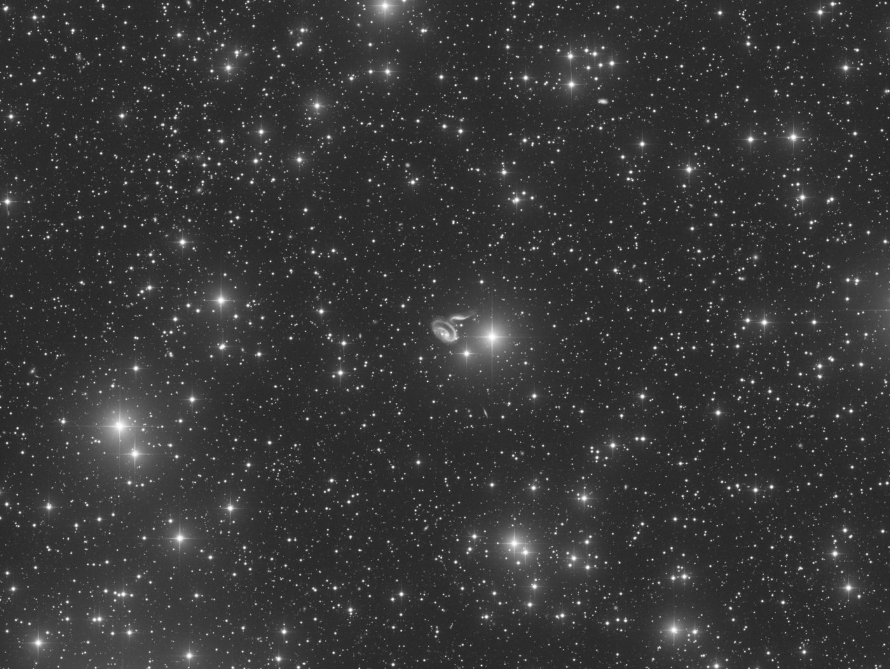
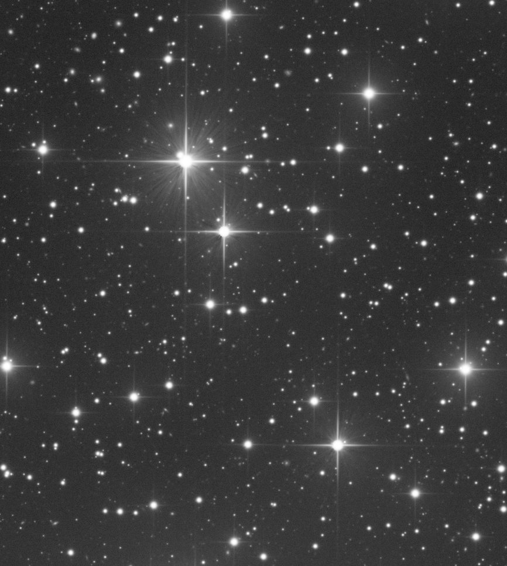
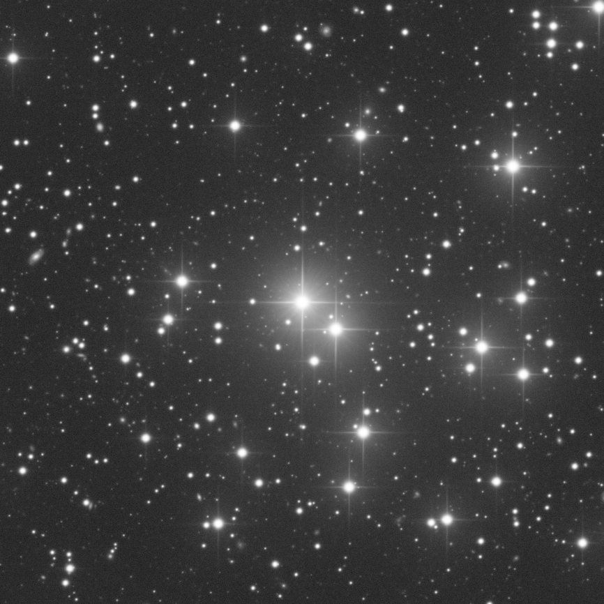
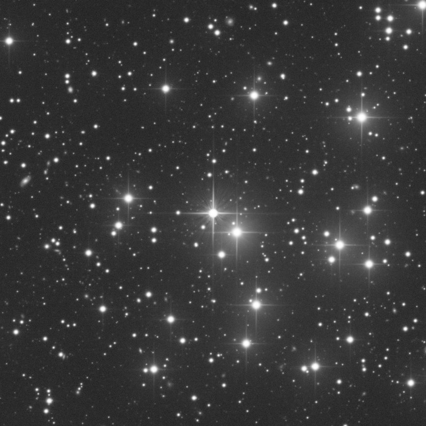
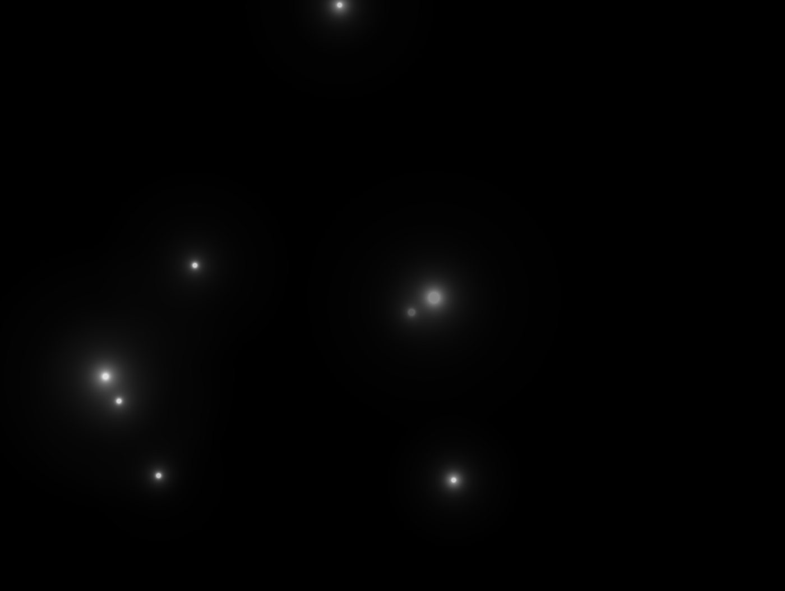

# Arp 273: dense star field next to a galaxy pair

| | |
|---|---|
| Data | Dark Matters Astro |
| Telescope / camera | PlaneWave CDK14, Moravian C5A-100M |
| Image | Luminance master, 11542 &times; 8676 px, 0.31"/px |
| Preparation | GradientCorrection (default parameters) |

Arp 273 is in a dense star field in Andromeda. The brightest star of the field is next to the galaxy pair.

## Problem with the default settings

With the default settings, the preview shows **dark areas** around the group of bright stars on the left and around
the stars at the bottom centre. In a dense field, the outskirts of each profile contain the light of many faint
stars, so the fitted tail is too flat (tail slopes below 1 in the star table) and the model stays too high far
from the star. A model that extends far with a high outer reduction removes too much there.

A first try with Max halo radius 2500 px and Outer reduction 0.80 still made dark areas at the bottom centre and on
the left. To find the right values, we measured the background median in rings around each star, relative to the
median of the image (units of 10<sup>-5</sup>; negative = darker than the field):

| Ring 900&ndash;1800 px | Before | Outer 0.80, Max halo r 2500 | Outer 0.50, Max halo r 2500 | **Outer 0.50, Max halo r 1500** |
|---|---|---|---|---|
| Star 7 (bottom centre) | &minus;0.8 | &minus;2.7 | &minus;1.7 | **&minus;0.5** |
| Star 2 (left) | +1.1 | &minus;0.5 | 0.0 | **&minus;0.1** |
| Star 6 (left) | &minus;0.2 | &minus;0.6 | &minus;0.3 | **&minus;0.5** |

Only the last setting has no ring that is clearly darker than before Dehalo.

Changes:

| Problem | Change |
|---|---|
| Over-subtraction far from the stars. | **Max halo radius 1500 px**, **Outer reduction 0.50** |
| The bright inner halo stays. | **Inner reduction 0.70**, **Protect radius 300 px**, **Transition 1000 px** |
| The galaxy pair is inside the rings of star 1. | Exclusion mask on the galaxies |

## Exclusion mask

Make the mask with PixelMath as in [NGC 3077](ngc-3077.md#exclusion-mask-for-the-galaxy), with this expression (an
ellipse around the galaxy pair, semi-axes 650 &times; 380 px):

```
iif(((x()-5840)/650)^2+((y()-4240)/380)^2<1,1,0)
```

## Settings

| Group | Setting | Value |
|---|---|---|
| Images | Exclusion mask | **galaxy pair ellipse** |
| Halo stars | Binning / Saturation / Min core r / Max stars | 4 / 0.95 / 6 / 8 |
| Model | Approach / Fit inner radius / Max halo radius | Empirical / 2.0 / **1500 px** |
| Model | Profile smoothing / Iterations | 0.50 / 3 |
| Reduction | Outer / Inner reduction | **0.50** / **0.70** |
| Reduction | Core protection / opacity | 0 / 0 (off) |
| Reduction | Protect radius / Transition width | **300 px** / **1000 px** |
| Reduction | Scale radii with star brightness | on |


## Result


  
  
</img-comparison-slider>
<div class="cmp-labels"><span>Before</span><span>After</span></div>

The galaxy pair and star 1 (2000 &times; 1600 px crop):


  
  
</img-comparison-slider>
<div class="cmp-labels"><span>Before</span><span>After</span></div>

The group of bright stars on the left (2600 &times; 2900 px crop):


  
  
</img-comparison-slider>
<div class="cmp-labels"><span>Before</span><span>After</span></div>

The stars at the bottom centre (2600 &times; 2600 px crop):


  
  
</img-comparison-slider>
<div class="cmp-labels"><span>Before</span><span>After</span></div>



## What to look at

- No dark areas around the star groups: the small Max halo radius and the outer reduction of 0.50 keep the model
  inside the real halos. In a dense field, prefer a lower outer reduction to a dark background.
- No core protection. Star 1, next to the galaxies, keeps a natural glow without it; core protection would add a
  brighter zone with a visible edge around it.
- The faint outer parts of the galaxies keep their light; they are inside the mask.
- Use the **hard stretch** in the preview to check a dense field. Over-subtraction shows as dark areas between the
  stars.
