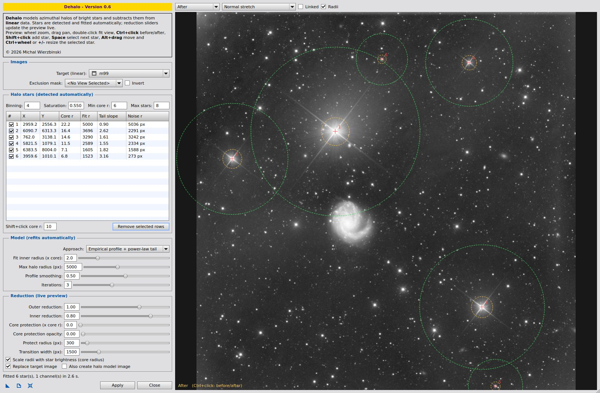
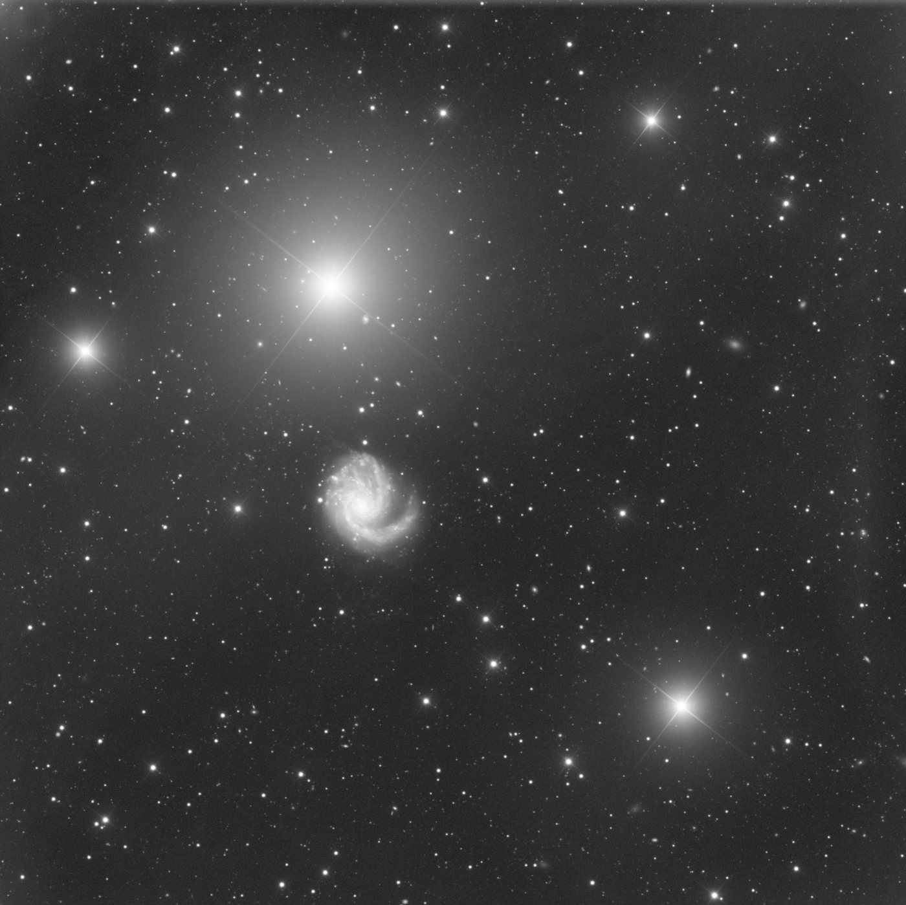
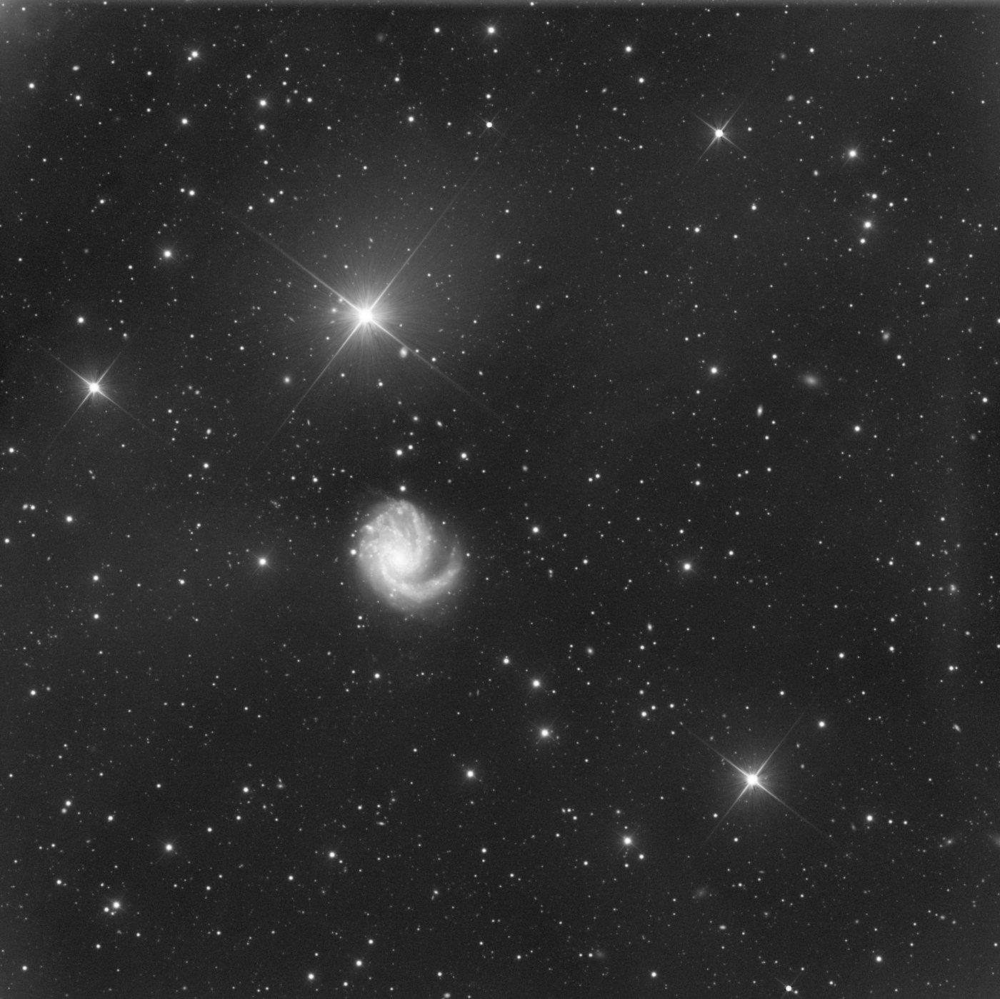
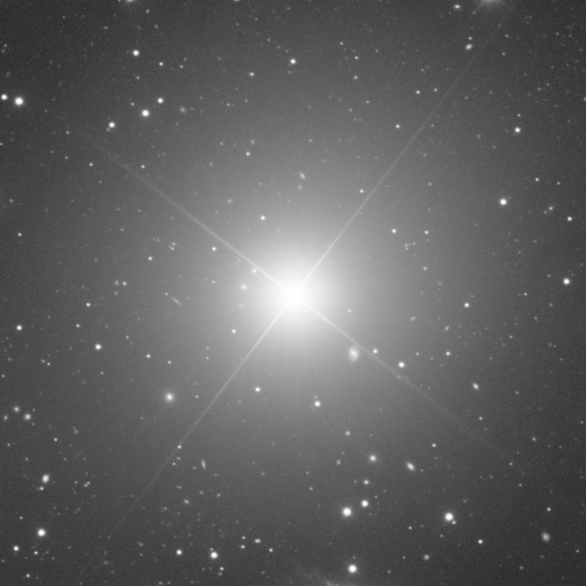
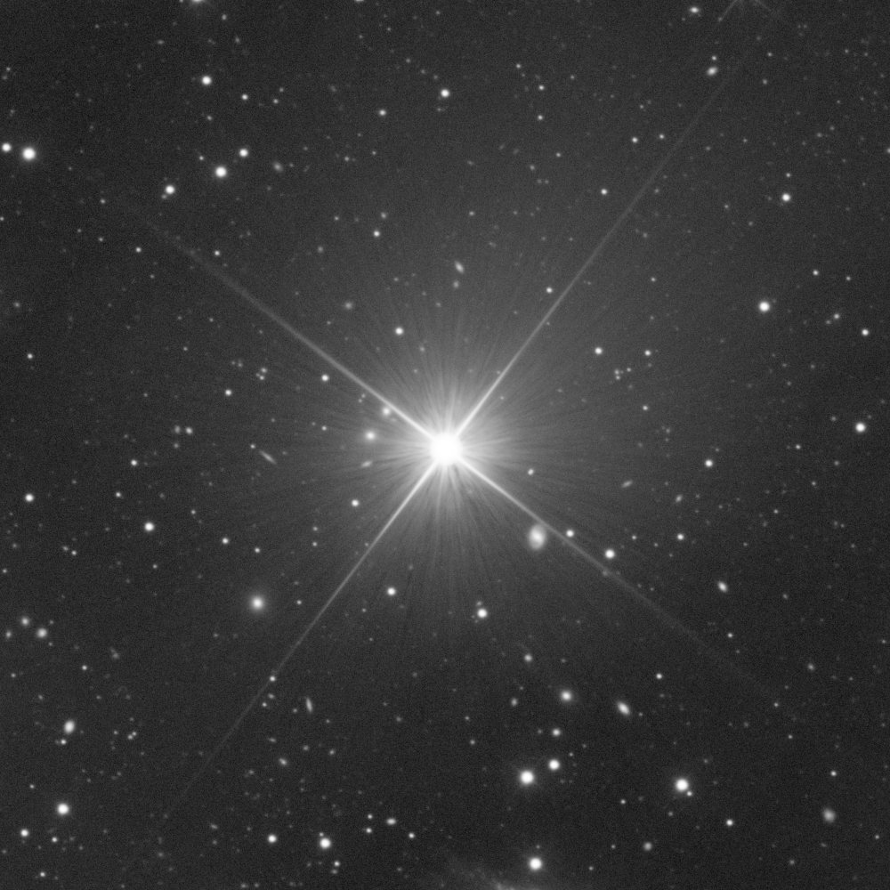
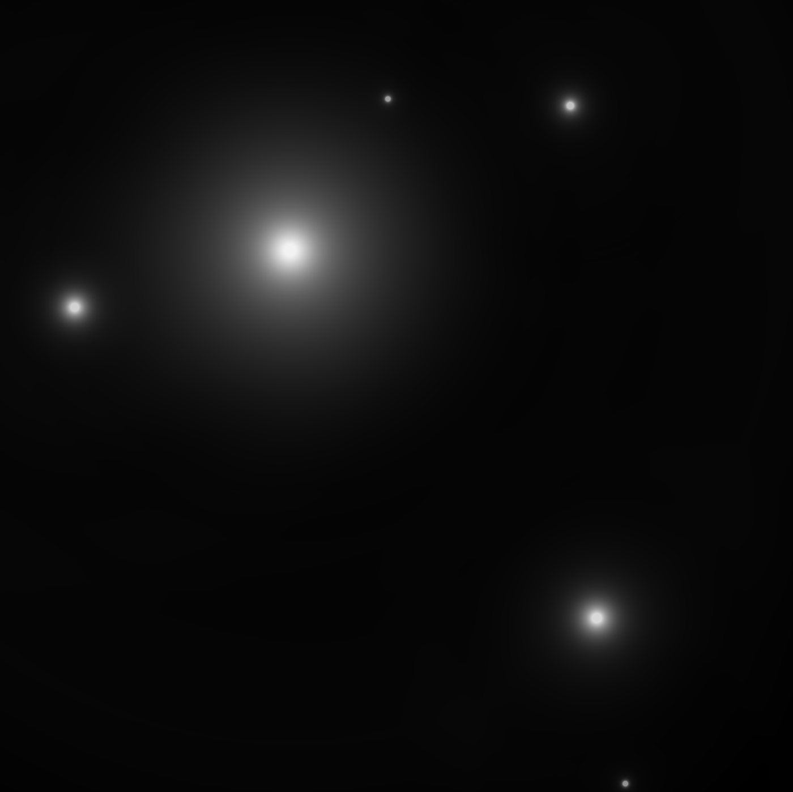

# M99: a master that saturates below 1

| | |
|---|---|
| Data | Bernard Miller |
| Telescope / camera | PlaneWave CDK17, FLI ProLine PL16803 |
| Image | Luminance master, 8098 &times; 8092 px, 0.64"/px |
| Preparation | GradientCorrection (default parameters) |

A bright star above the galaxy M99 (in the image) has a large halo. With the default settings, Dehalo finds
**no stars** in this master.

## Why no stars are found

The maximum value of this master is 0.656, not 1.0: integration scaled the frames. The default **Saturation** is
0.95, so no pixel counts as saturated. Move the cursor over the centre of the bright stars and read the values:

| Star | Flat core level |
|---|---|
| The brightest star (above M99) | 0.597 |
| The star at the bottom right | 0.636 |
| The star on the left edge | 0.650 |

With **Saturation 0.55**, all of these stars are detected. Six stars are found.

## Settings

| Group | Setting | Value |
|---|---|---|
| Halo stars | Binning / Saturation / Min core r / Max stars | 4 / **0.55** / 6 / 8 |
| Halo stars | Ticked stars | all 6 |
| Model | Approach / Fit inner radius / Max halo radius | Empirical / 2.0 / 5000 px |
| Model | Profile smoothing / Iterations | 0.50 / 3 |
| Reduction | Outer / Inner reduction | 1.00 / **0.80** |
| Reduction | Protect radius / Transition width | **300 px** / 1500 px |
| Reduction | Scale radii with star brightness | on |

## Result

  
  
</img-comparison-slider>

BeforeAfter

The brightest star at full resolution (3000 &times; 3000 px crop):

  
  
</img-comparison-slider>

BeforeAfter

## What to look at

- **Saturation.** Always check the core level of a bright star when Dehalo finds no stars, or fewer than you
  expect.
- **Inner reduction and protect radius.** With the defaults (inner 0.30, protect 600 px), the bright halo near the
  star stays. With inner 0.80 and protect 300 px, it is removed, and the background galaxies near the star are
  easier to see.
- **The galaxy.** M99 is about 1300 px from the star, inside its rings. The profile is a clipped median of each
  ring, so the galaxy (a small part of the ring) does not change the model much. For a galaxy nearer to the star,
  use an exclusion mask ([NGC 3077](ngc-3077.md)).
