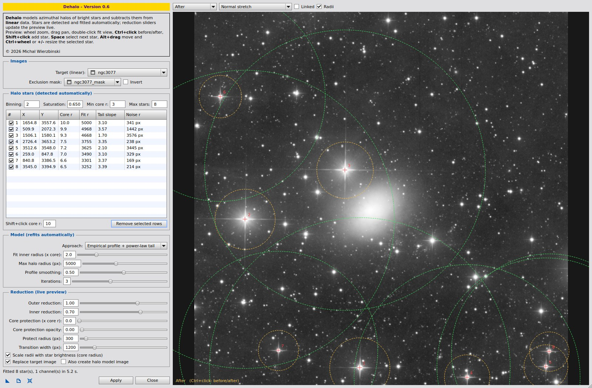
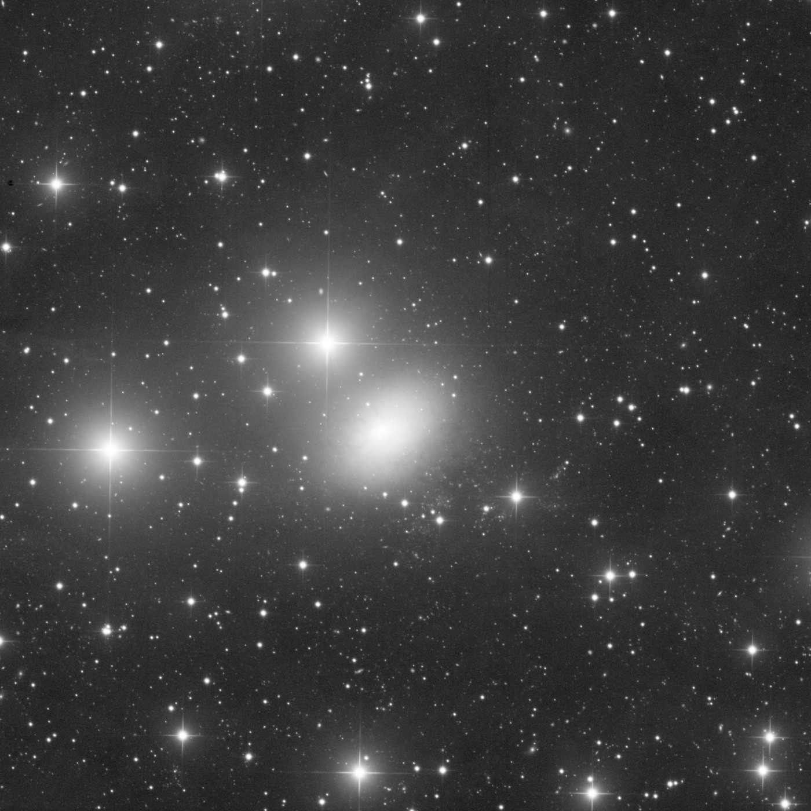
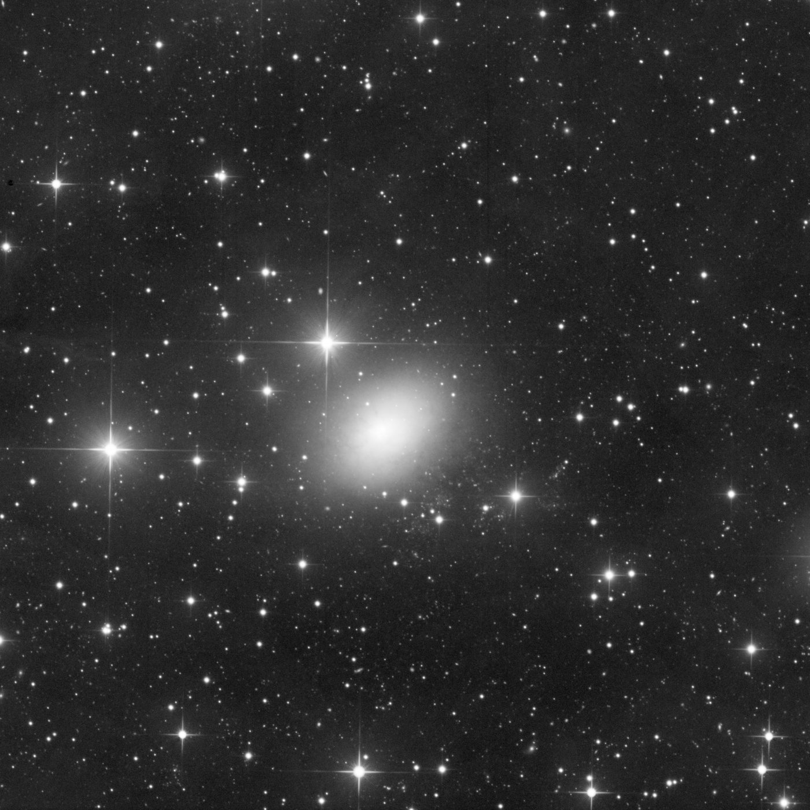
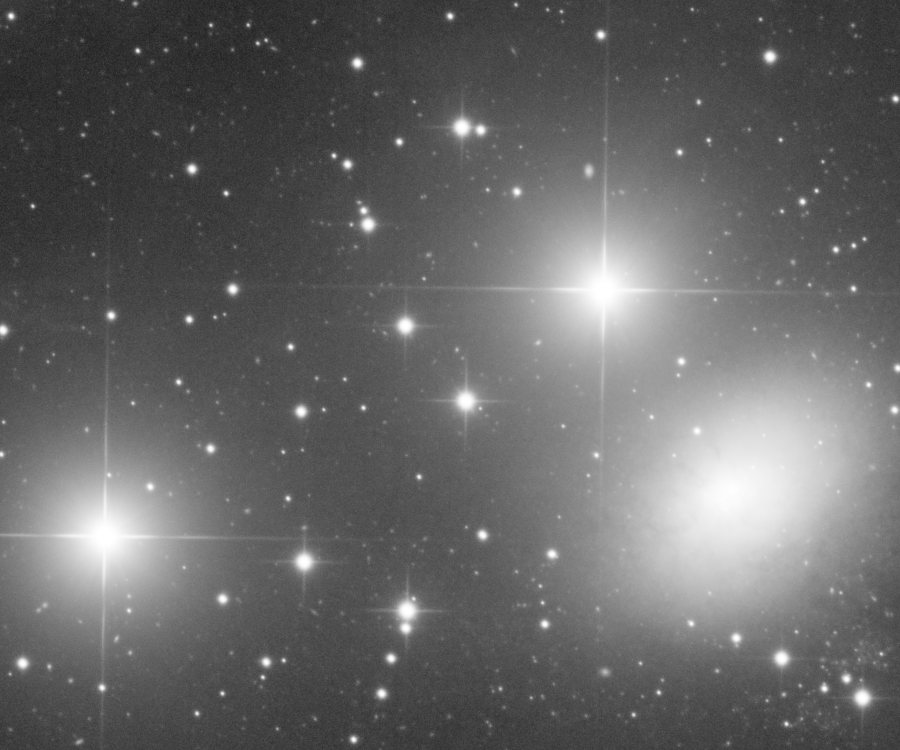
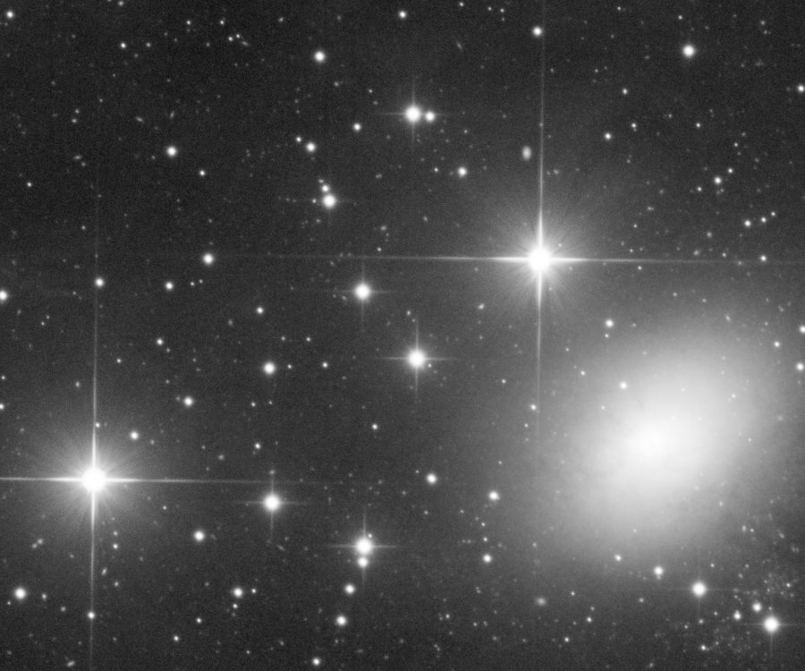
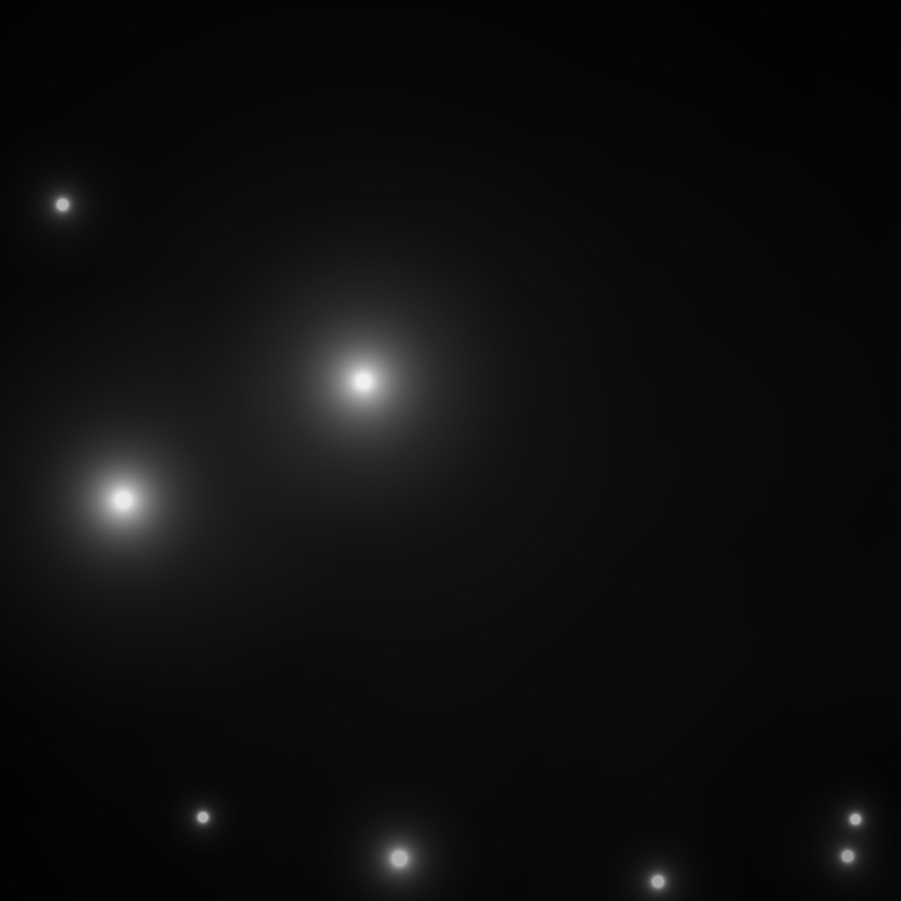

# NGC 3077: small image, small cores, galaxy mask

| | |
|---|---|
| Data | SWOS |
| Telescope / camera | PlaneWave CDK24, SBIG STX-16803 |
| Image | Luminance master, 3735 &times; 3735 px, 0.47"/px |
| Preparation | GradientCorrection (default parameters) |

NGC 3077 is next to two bright stars. The image is small and the star cores are small, so the default detection finds
**no stars**. The galaxy is about 400 px from star 3, inside its halo.

## Detection

| Problem | Change |
|---|---|
| The flat cores of the bright stars are at 0.71 and 0.74, below the default Saturation 0.95. | **Saturation 0.65** |
| The saturated cores are only about 8 px wide. | **Min core r 3** |
| The image is small: with binning 4, the profile near the star has few points. | **Binning 2** |

With these values, 8 stars are found.

## Exclusion mask for the galaxy

The light of the galaxy is inside the rings of star 3. Without a mask, a part of the galaxy goes into the halo model
of the star and is subtracted. An exclusion mask removes the galaxy pixels from the fit; the model is still
subtracted from all pixels.

Make the mask with PixelMath:

1. Open **PixelMath**. Enter this expression (an ellipse at x = 1778, y = 1974, semi-axes 450 &times; 350 px):

    ```
    iif(((x()-1778)/450)^2+((y()-1974)/350)^2<1,1,0)
    ```

2. In **Destination**, tick **Create new image**, select **Gray** and enter an identifier, for example
   `galaxy_mask`. Apply PixelMath to the image. The new image has the same size as the image.
3. In Dehalo, select `galaxy_mask` as the **Exclusion mask**.

Any mask works: pixels above 0.5 are excluded. A mask with white structures on a black background is used as it
is; a protection mask (black structures) needs **Invert**.

## Settings

| Group | Setting | Value |
|---|---|---|
| Images | Exclusion mask | **galaxy_mask** |
| Halo stars | Binning / Saturation / Min core r / Max stars | **2** / **0.65** / **3** / 8 |
| Model | Approach / Fit inner radius / Max halo radius | Empirical / 2.0 / 5000 px |
| Model | Profile smoothing / Iterations | 0.50 / 3 |
| Reduction | Outer / Inner reduction | 1.00 / **0.70** |
| Reduction | Protect radius / Transition width | **300 px** / **1200 px** |
| Reduction | Scale radii with star brightness | on |



## Result


  
  
</img-comparison-slider>
<div class="cmp-labels"><span>Before</span><span>After</span></div>

The galaxy and the two bright stars (1800 &times; 1500 px crop):


  
  
</img-comparison-slider>
<div class="cmp-labels"><span>Before</span><span>After</span></div>



## What to look at

- The halos of the two stars are reduced, and the galaxy keeps all of its light. The removed halo image has no
  galaxy shape in it.
- Small images need **Binning 2**. The profile starts at 2 &times; the core radius, and with binning 4 there are
  too few bins near a small core.
