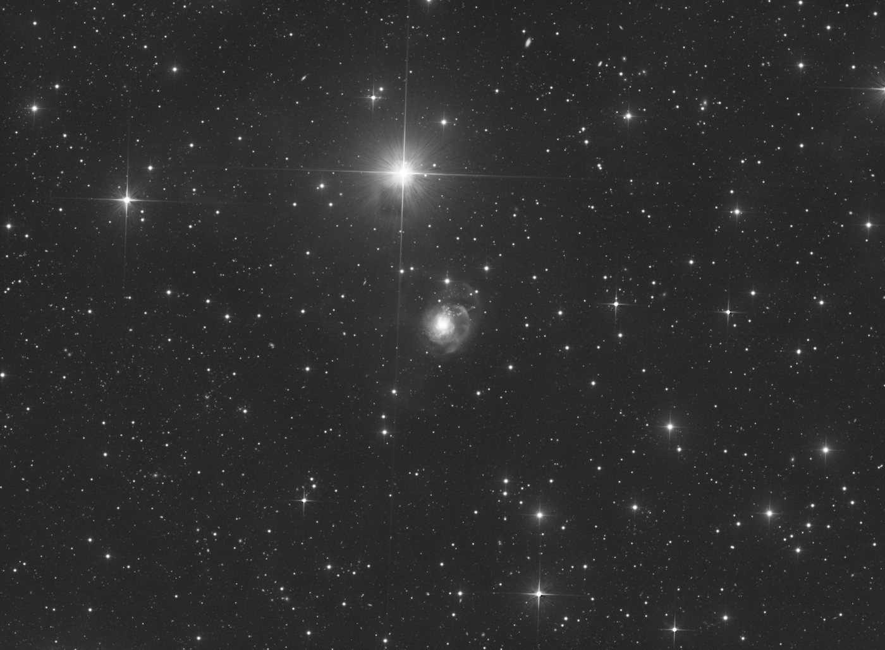
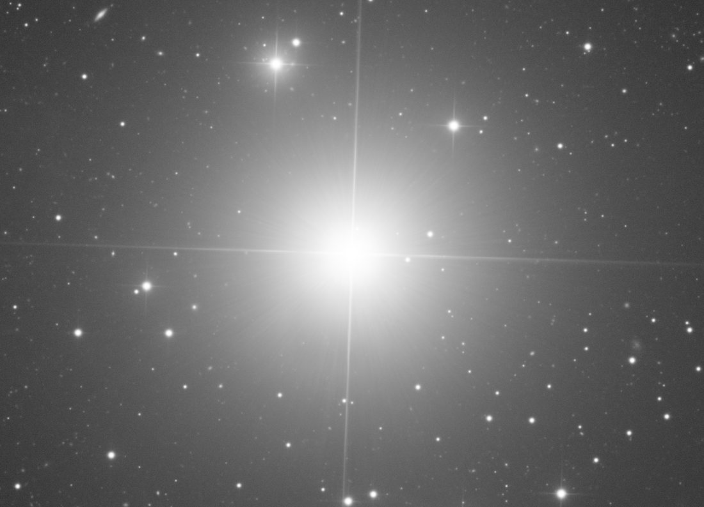
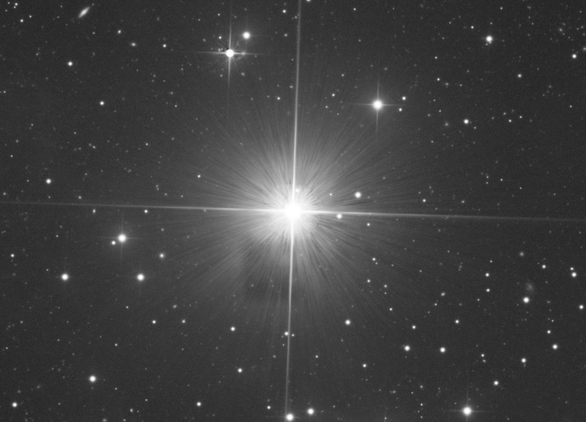
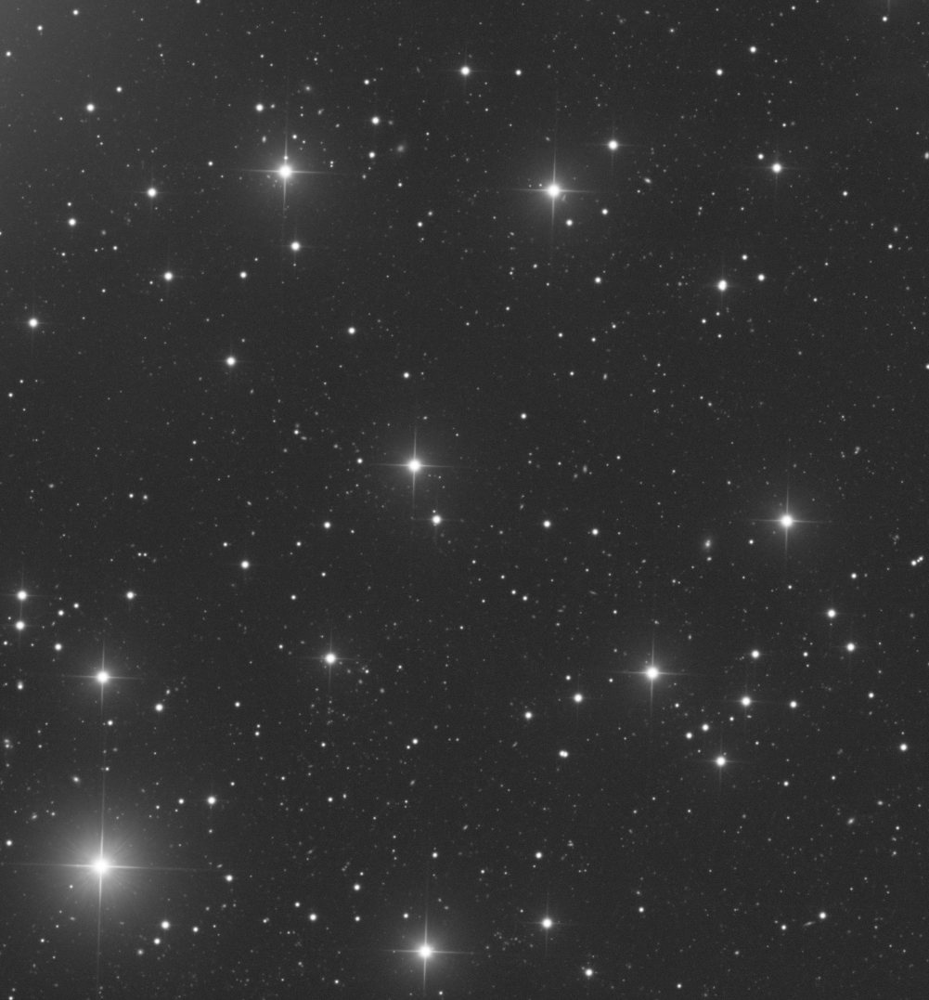
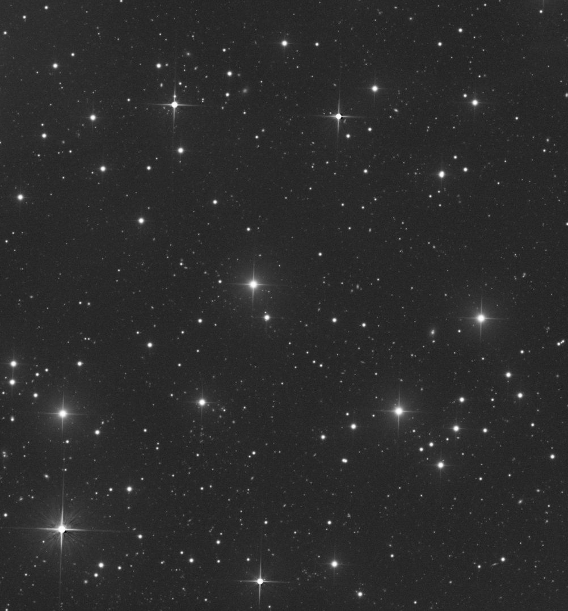
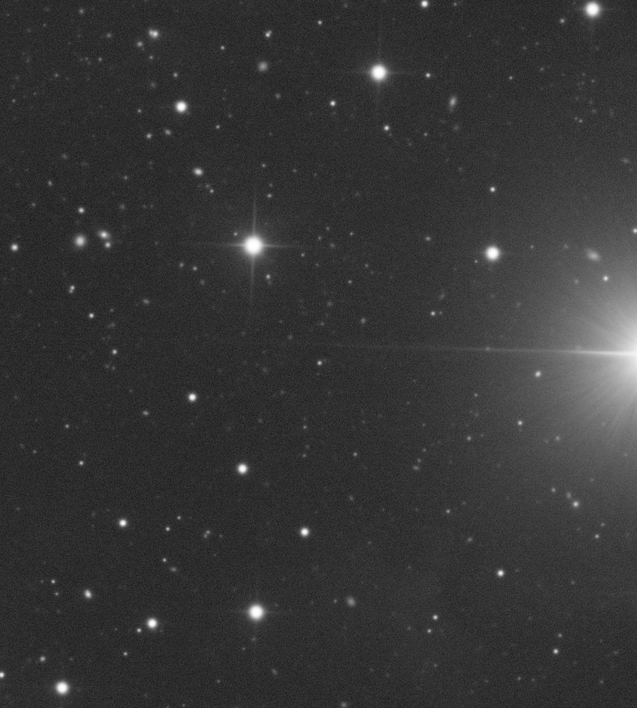
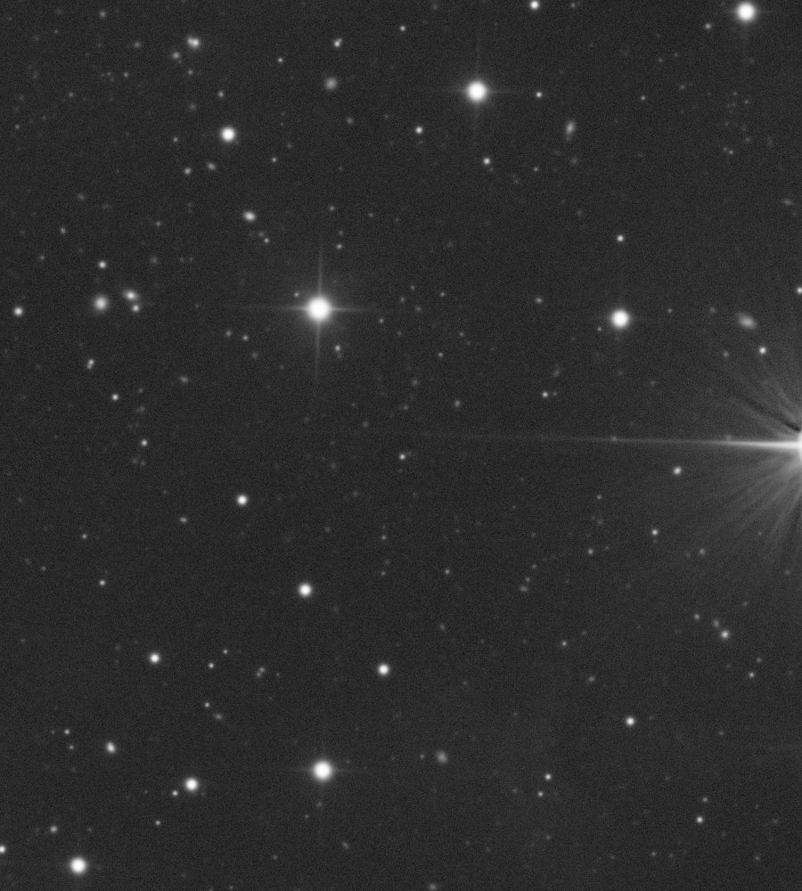
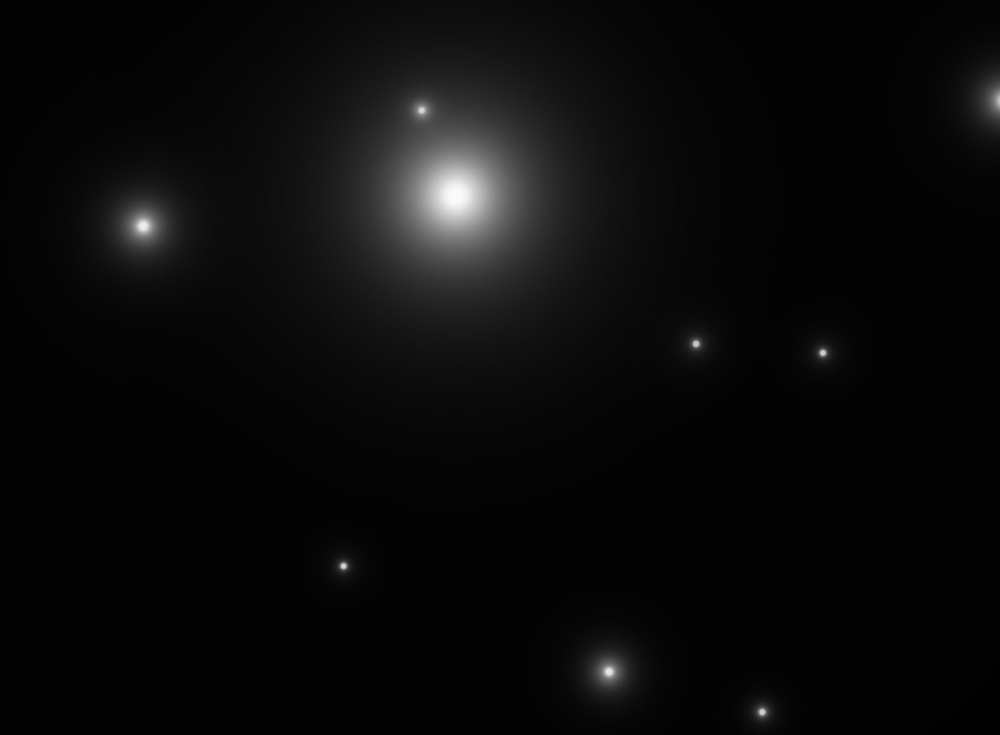

# NGC 3310: a field-wide halo

| | |
|---|---|
| Data | Dark Matters Astro |
| Telescope / camera | PlaneWave CDK14, Moravian C5A-100M |
| Image | Luminance master, 11405 &times; 8388 px, 0.31"/px |
| Preparation | GradientCorrection (default parameters) |

HD 92095 and a second bright star are next to the galaxy NGC 3310. Their halos cover a large part of the field. Six
smaller stars with saturated cores add their own halos. A ninth bright star is just outside the right edge of the
frame; its halo and a diffraction spike come into the image at the top of the right edge. All eight detected stars
are ticked, and the star outside the frame is added by hand.

This is the same run as in the [Quick start](../quick-start.md).

## Settings

Values that are different from the defaults are in **bold**.

| Group | Setting | Value |
|---|---|---|
| Halo stars | Binning / Saturation / Min core r / Max stars | 4 / 0.95 / 6 / 8 |
| Halo stars | Ticked stars | all 8 detected stars |
| Halo stars | Manual star | **x 11455, y 1148, core r 15** (outside the frame) |
| Model | Approach | Empirical profile + power-law tail |
| Model | Fit inner radius / Max halo radius | 2.0 / **6952 px** |
| Model | Profile smoothing / Iterations | 0.50 / 3 |
| Reduction | Outer / Inner reduction | **0.86** / **0.82** |
| Reduction | Core protection / opacity | 0 / 0 |
| Reduction | Protect radius / Transition width | **1194 px** / **2425 px** |
| Reduction | Scale radii with star brightness | on |

## Result

  
  
</img-comparison-slider>

BeforeAfter

HD 92095 at full resolution (3600 &times; 2600 px crop):

  
  
</img-comparison-slider>

BeforeAfter

!!! note "Dark patch and marks near HD 92095"
    After Dehalo, a dark patch is visible below and to the left of HD 92095, and there are dark marks and radial
    streaks close to its core. These are most likely stacking and normalization artifacts in the master, not
    artifacts of Dehalo. Pixel rejection and normalization work differently near a saturated star, so the area
    around the core is not uniform in the integrated master. In the original image, the bright halo hides these
    structures; when the halo is removed, they become visible.

    The removed halo (below) is smooth and the same in all directions around the star: at each distance it removes
    the same value in every direction. So any difference between the directions is in the master before Dehalo.
    We measured it: in the ring 150&ndash;300 px from the star, the original master below the star is 7 to 18
    &times; 10-5 darker than the median of the ring, and above and to the left of the star it is up to
    20 &times; 10-5 brighter. The noise of these sector medians is about 0.1 &times; 10-5.
    In the original image, the bright halo hides this difference; Dehalo removes the halo and makes it visible.

The second star (1800 &times; 1300 px crop):

  
  
</img-comparison-slider>

BeforeAfter

The lower right part of the field with four of the smaller stars (5000 &times; 5400 px crop):

  
  
</img-comparison-slider>

BeforeAfter

The top of the right edge, with the halo of the star outside the frame (1800 &times; 2000 px crop):

  
  
</img-comparison-slider>

BeforeAfter

The removed halo (the `_halomodel` image, stretched):

## What to look at

- **A star outside the frame.** Its centre is not in the image, so detection cannot find it. We measured the
  background along the right edge: the halo is brightest at y = 1148, where the diffraction spike enters the image,
  and a radial fit of its decrease puts the centre about 50 px outside the edge. With the manual star at
  (11455, 1148), the halo at the edge is removed; the background 400&ndash;900 px from it goes from 1.3 to 0.0
  &times; 10-5 above the image median. See
  [Stars outside the frame](../controls.md#stars-outside-the-frame).
- **All stars together.** All stars and the sky plane are fitted together, so the halos of the smaller stars are
  separated from the large halo of HD 92095 around them. To keep the halo of a star, untick it; it stays in the fit.
- **Small stars at full resolution.** With inner reduction 0.82 and no core protection, the edge of a small star
  core can become hard, and a slightly lopsided core can get a dark notch on one side. This is visible only at full
  resolution. If it shows in your image, use Core protection 3 with opacity 0.5
  (see [Troubleshooting](../troubleshooting.md#a-dark-patch-on-one-side-of-a-star)).
- **High inner reduction.** With 0.82, most of the bright inner halo of HD 92095 is removed. The diffraction spikes
  and the star core stay; they are not part of the azimuthal model.
- **Artifacts in the master.** The dark patch and the marks near HD 92095 are in the data (see the note above).
  Dehalo makes them visible because it removes the halo that covered them. Fix them in the integration (for
  example other rejection or normalization settings) or with retouching tools after Dehalo.
- **Large Max halo radius.** The halo of HD 92095 reaches over most of the field. With the default 5000 px, the
  outer part of the halo would stay.
