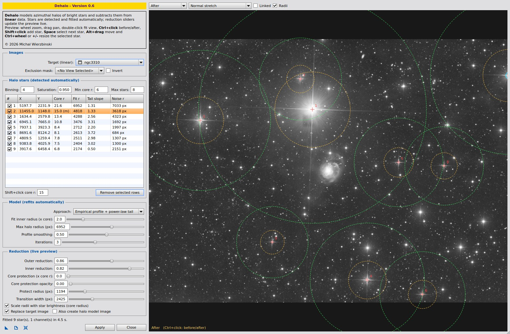
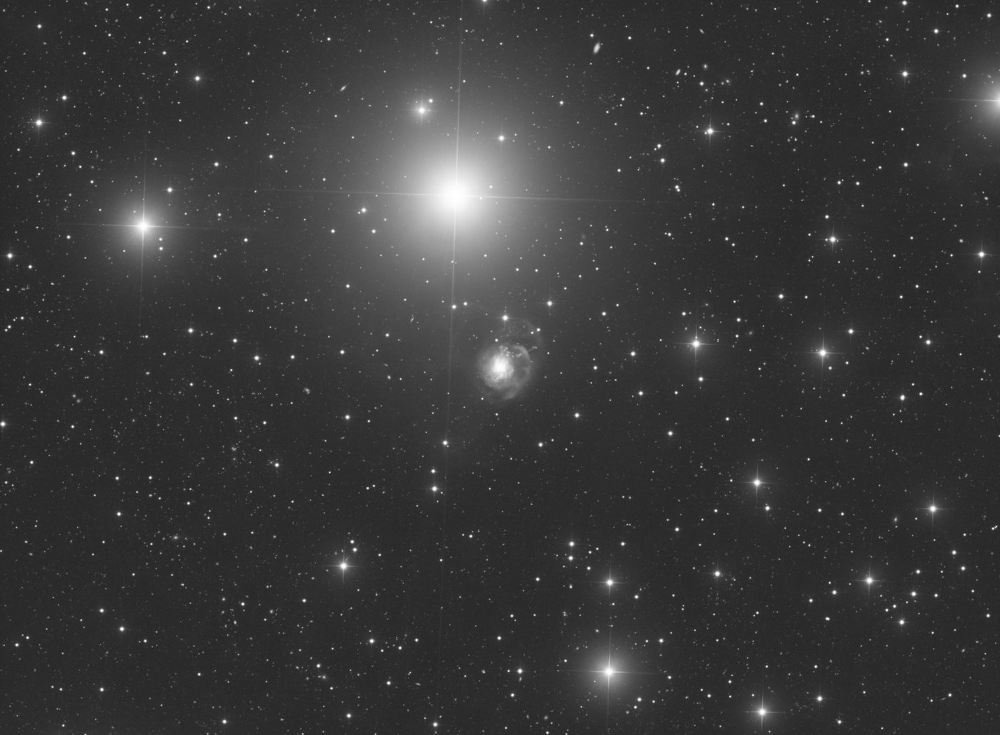
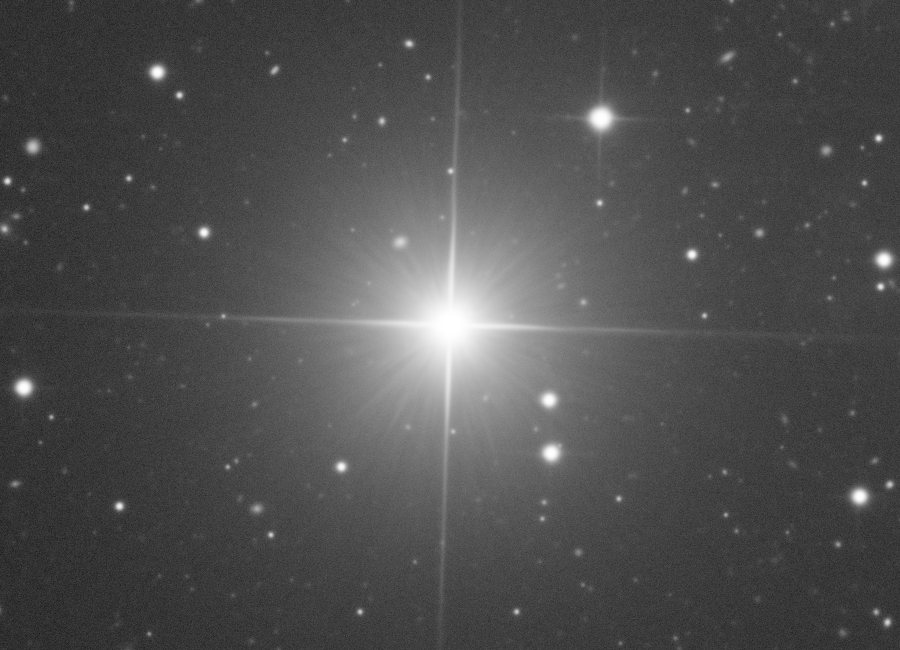
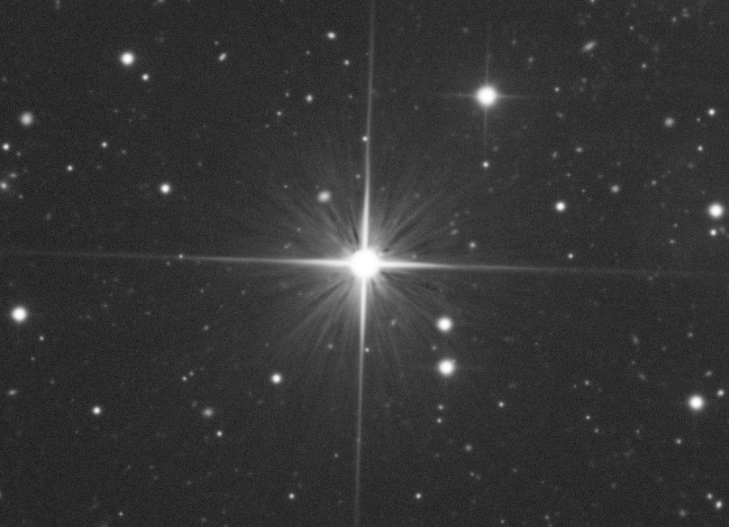

# NGC 3310: only the two brightest stars

| | |
|---|---|
| Data | Dark Matters Astro |
| Telescope / camera | PlaneWave CDK14, Moravian C5A-100M |
| Image | Luminance master, 11405 &times; 8388 px, 0.31"/px |
| Preparation | GradientCorrection (default parameters) |

HD 92095 and a second bright star are next to the galaxy NGC 3310. Their halos cover a large part of the field. The
other detected stars have small halos that look natural, so we keep them: only stars 1 and 2 are ticked.

This is the same run as in the [Quick start](../quick-start.md).

## Settings

Values that are different from the defaults are in **bold**.

| Group | Setting | Value |
|---|---|---|
| Halo stars | Binning / Saturation / Min core r / Max stars | 4 / 0.95 / 6 / 8 |
| Halo stars | Ticked stars | **1 and 2 only** |
| Model | Approach | Empirical profile + power-law tail |
| Model | Fit inner radius / Max halo radius | 2.0 / **6952 px** |
| Model | Profile smoothing / Iterations | 0.50 / 3 |
| Reduction | Outer / Inner reduction | **0.86** / **0.82** |
| Reduction | Core protection / opacity | 0 / 0 |
| Reduction | Protect radius / Transition width | **1194 px** / **2425 px** |
| Reduction | Scale radii with star brightness | on |

## Result

  
  
</img-comparison-slider>

BeforeAfter

HD 92095 at full resolution (3600 &times; 2600 px crop):

  
  
</img-comparison-slider>

BeforeAfter

!!! note "Dark patch and marks near HD 92095"
    After Dehalo, a dark patch is visible below and to the left of HD 92095, and there are dark marks and radial
    streaks close to its core. These are most likely stacking and normalization artifacts in the master, not
    artifacts of Dehalo. Pixel rejection and normalization work differently near a saturated star, so the area
    around the core is not uniform in the integrated master. In the original image, the bright halo hides these
    structures; when the halo is removed, they become visible.

    The removed halo (below) is smooth and the same in all directions around the star. Subtracting it cannot make
    a dark patch on one side of the star only, so a one-sided structure must be in the data before Dehalo. To
    check this in PixInsight, look at the original master around the star with a hard STF stretch.

The second star (1800 &times; 1300 px crop):

  
  
</img-comparison-slider>

BeforeAfter

The removed halo (the `_halomodel` image, stretched):

## What to look at

- **Untick instead of remove.** Stars 3 to 8 stay in the fit. Their light is still in the model of the field, so
  the two large halos are measured correctly, but their own halos are not subtracted.
- **High inner reduction.** With 0.82, most of the bright inner halo of HD 92095 is removed. The diffraction spikes
  and the star core stay; they are not part of the azimuthal model.
- **Artifacts in the master.** The dark patch and the marks near HD 92095 are in the data (see the note above).
  Dehalo makes them visible because it removes the halo that covered them. Fix them in the integration (for
  example other rejection or normalization settings) or with retouching tools after Dehalo.
- **Large Max halo radius.** The halo of HD 92095 reaches over most of the field. With the default 5000 px, the
  outer part of the halo would stay.
