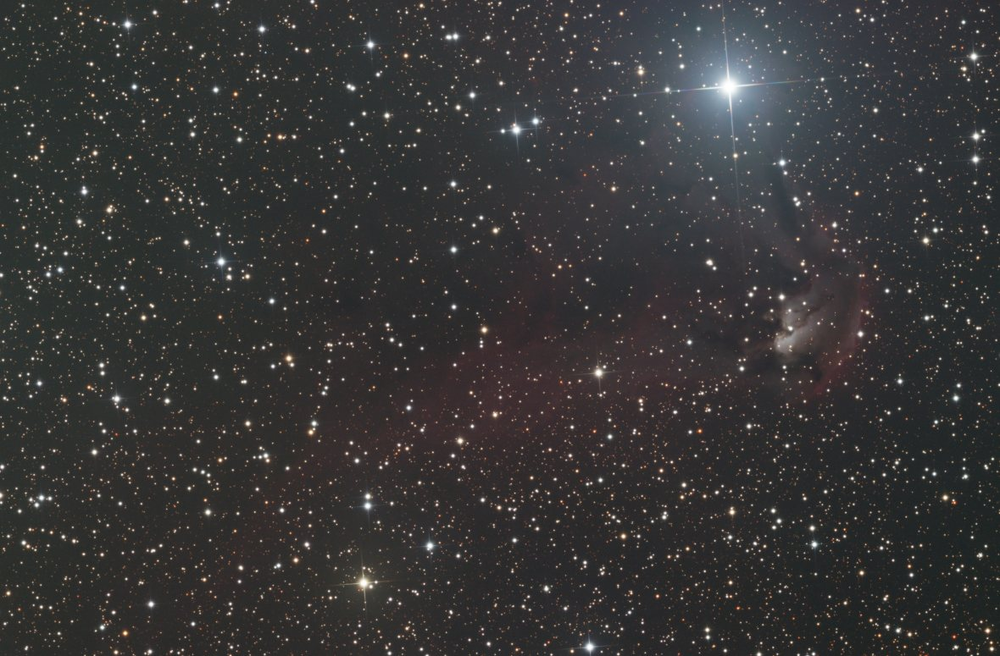
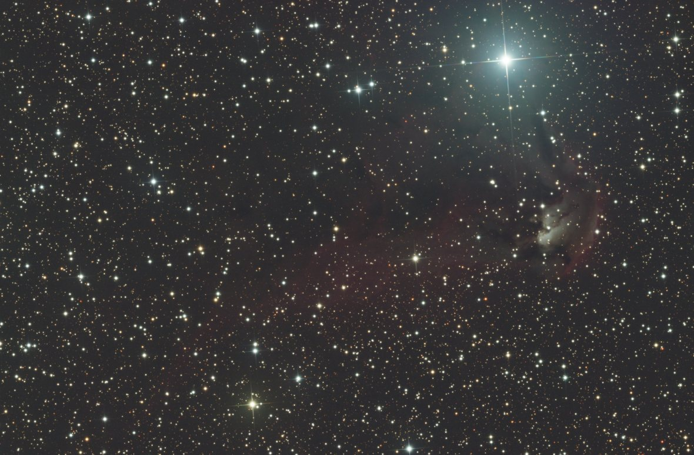
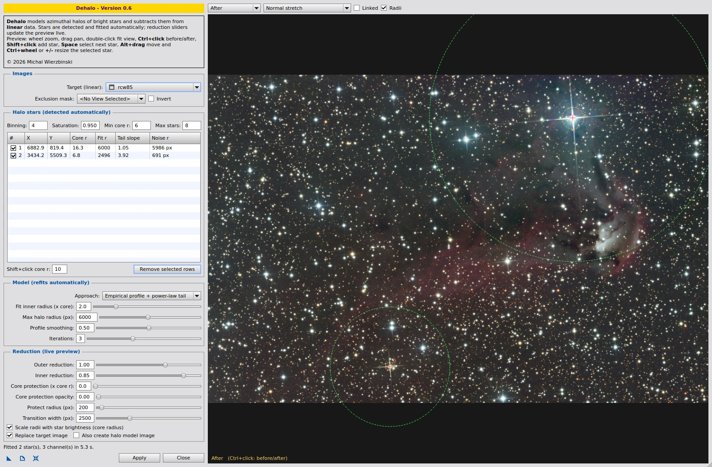
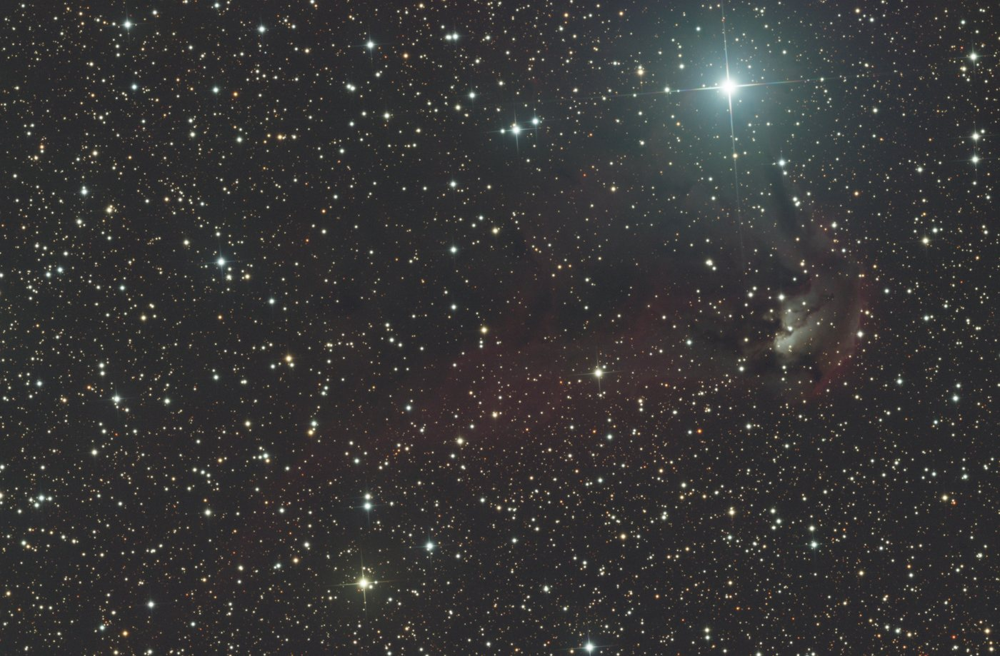
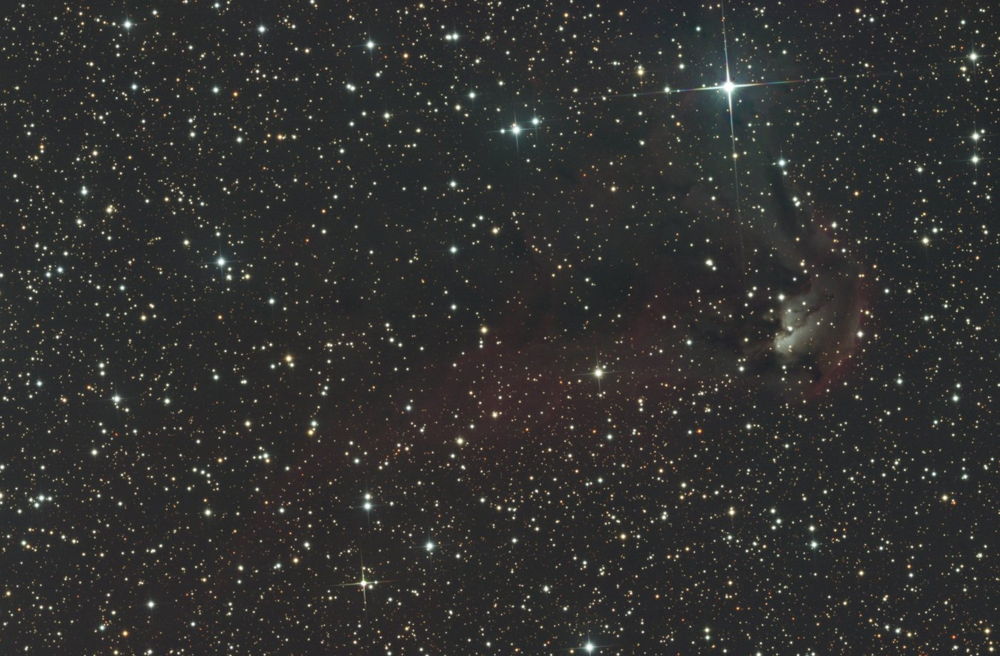
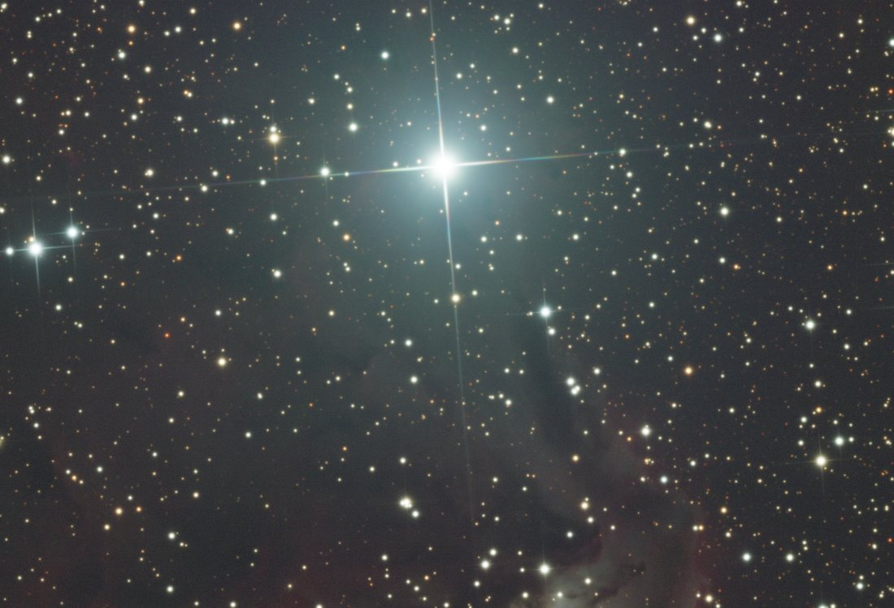
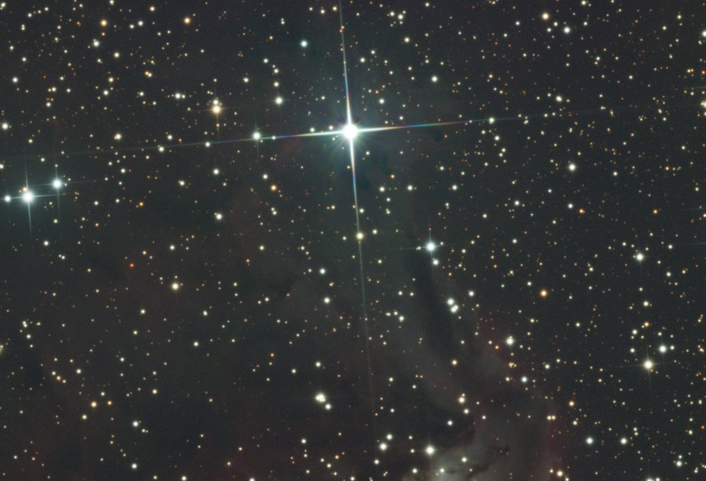
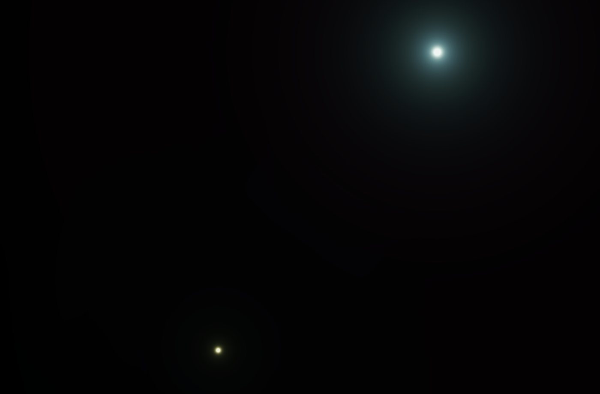

# RCW 85: RGB image with one very bright star

| | |
|---|---|
| Data | Dark Matters Astro |
| Telescope / camera | PlaneWave CDK20, QHY 600M |
| Image | RGB composite of the R, G and B masters, 9447 &times; 6203 px, 0.22"/px |
| Preparation | GradientCorrection on each master, ChannelCombination, BackgroundNeutralization |

A very bright star at the top of the field has a large blue-cyan halo that covers a part of the RCW 85 nebula.

## Preparation

1. GradientCorrection (default parameters) on the R, G and B masters.
2. ChannelCombination (RGB) of the three masters.
3. BackgroundNeutralization (default parameters) on the composite.

See [Preparing images](../preparing-images.md#rgb-composites). The images on this page use a linked stretch.

  
  
</img-comparison-slider>

Composite of the masters (unlinked)After preparation (linked)

## Settings

Dehalo finds two stars. Each of the three channels gets its own model.

| Group | Setting | Value |
|---|---|---|
| Halo stars | Binning / Saturation / Min core r / Max stars | 4 / 0.95 / 6 / 8 |
| Model | Approach / Fit inner radius / Max halo radius | Empirical / 2.0 / **6000 px** |
| Model | Profile smoothing / Iterations | 0.50 / 3 |
| Reduction | Outer / Inner reduction | 1.00 / **0.85** |
| Reduction | Protect radius / Transition width | **200 px** / **2500 px** |
| Reduction | Scale radii with star brightness | on |
| Preview | Linked | on |

## Result

  
  
</img-comparison-slider>

BeforeAfter

The bright star (4400 &times; 3000 px crop):

  
  
</img-comparison-slider>

BeforeAfter

## What to look at

- **Colour of the halo.** The halo is bluer than the star field, because the scattered light is not the same in each
  filter. Each channel has its own model, so the blue-cyan glow is removed and the star colours stay.
- **Strong inner reduction.** With inner reduction 0.60 and protect radius 400 px, a cyan glow stayed around the
  star. With 0.85 and 200 px it is removed.
- **Max halo radius 6000 px.** The halo of this star extends over a large part of the field.
