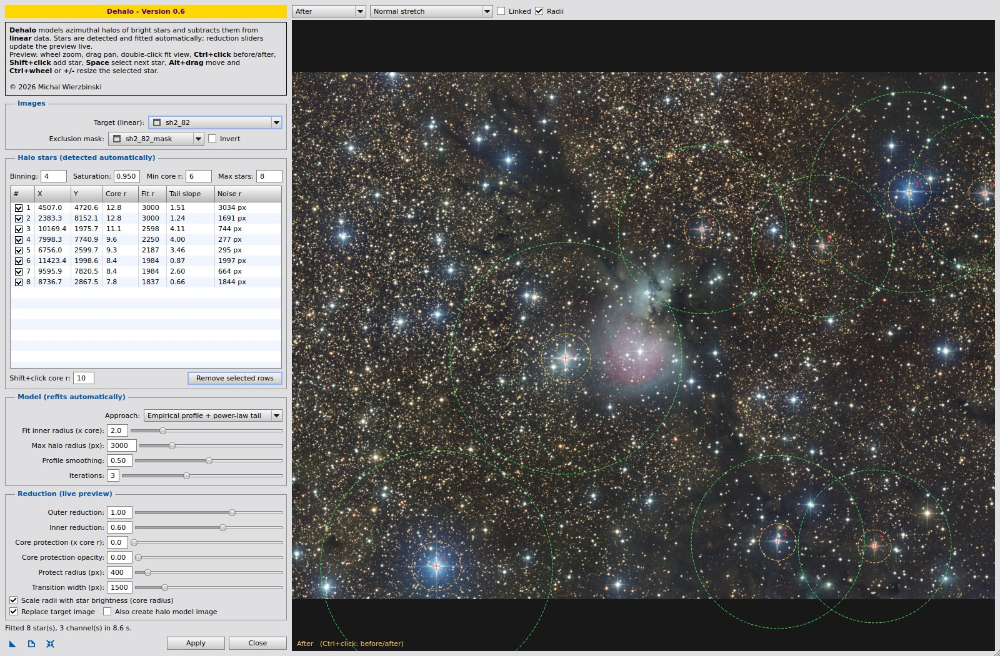
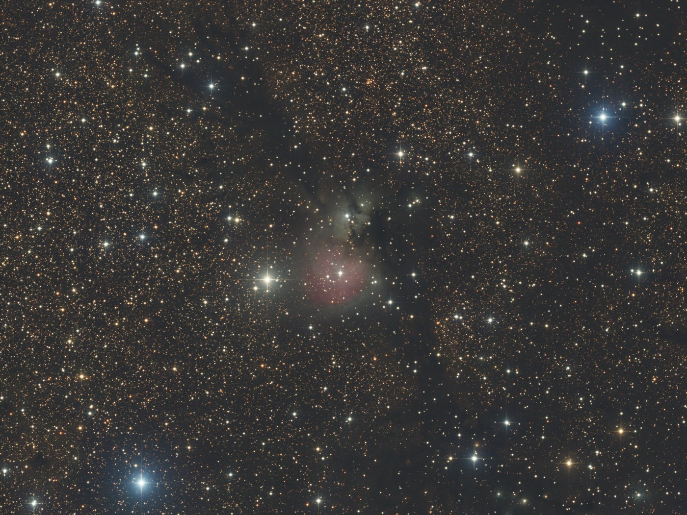
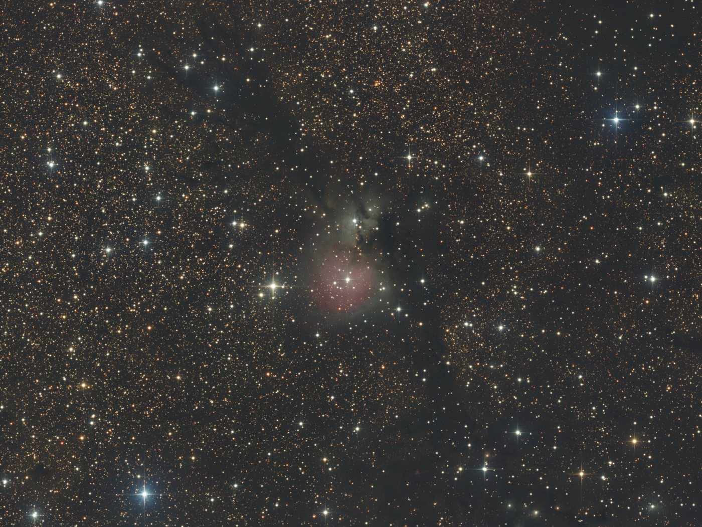
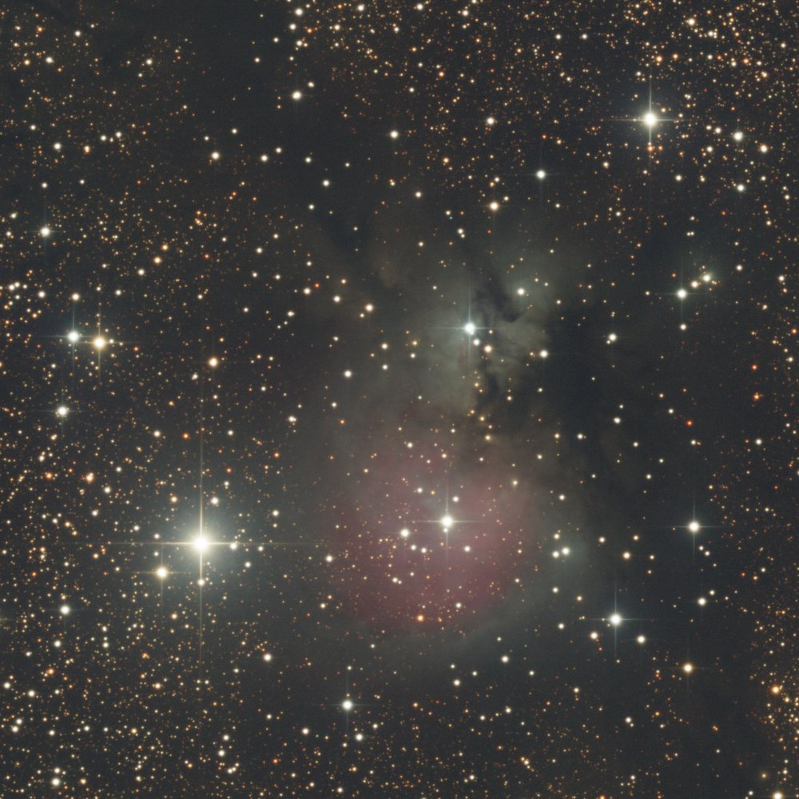
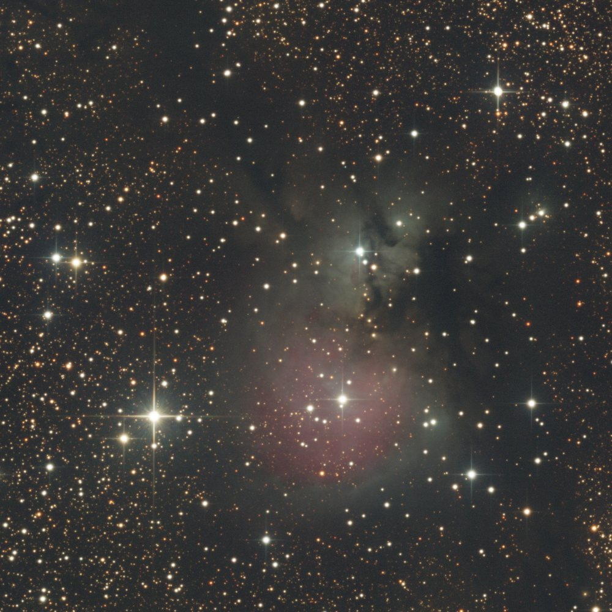
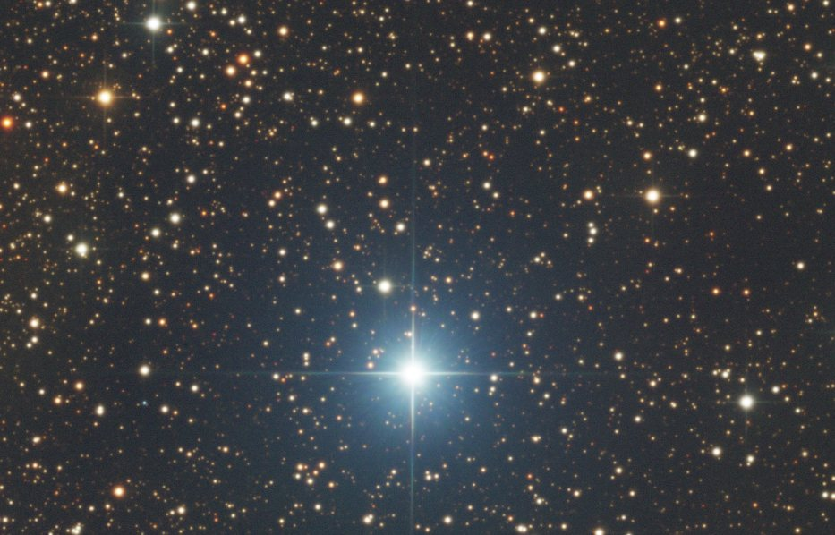
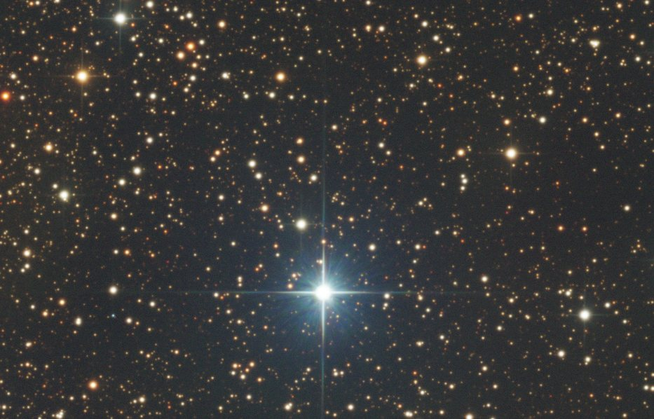
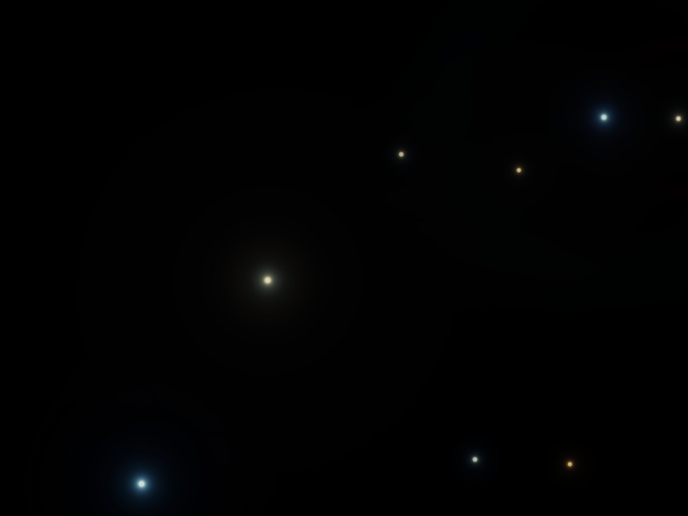

# Sh2-82: RGB image with a nebula inside the halo

| | |
|---|---|
| Data | Dark Matters Astro |
| Telescope / camera | PlaneWave CDK14, Moravian C5A-100M |
| Image | RGB composite of the R, G and B masters, 11590 &times; 8696 px, 0.31"/px |
| Preparation | GradientCorrection on each master, ChannelCombination, BackgroundNeutralization |

Sh2-82, the Little Cocoon, is an emission and reflection nebula in Sagitta. A bright star (star 1) is about 1200 px
from the nebula, so the nebula is inside the rings of its halo. The field also has several bright blue stars with
large halos.

## Exclusion mask for the nebula

Without a mask, the light of the nebula goes into the profile of star 1, and the model subtracts a ring of
"nebula light" around the star in all directions. The mask removes the nebula pixels from the fit.

Make the mask with PixelMath as in [NGC 3077](ngc-3077.md#exclusion-mask-for-the-galaxy), with this expression. The
ellipse covers the red emission region and the reflection nebula above it (centre x = 5800, y = 4200, semi-axes
750 &times; 1150 px):

```
iif(((x()-5800)/750)^2+((y()-4200)/1150)^2<1,1,0)
```

## Settings

| Group | Setting | Value |
|---|---|---|
| Images | Exclusion mask | **nebula ellipse** |
| Halo stars | Binning / Saturation / Min core r / Max stars | 4 / 0.95 / 6 / 8 |
| Model | Approach / Fit inner radius / Max halo radius | Empirical / 2.0 / **3000 px** |
| Model | Profile smoothing / Iterations | 0.50 / 3 |
| Reduction | Outer / Inner reduction | 1.00 / **0.60** |
| Reduction | Protect radius / Transition width | **400 px** / 1500 px |
| Reduction | Scale radii with star brightness | on |
| Preview | Linked | on |



## Result


  
  
</img-comparison-slider>
<div class="cmp-labels"><span>Before</span><span>After</span></div>

The nebula and star 1 (4000 &times; 4000 px crop):


  
  
</img-comparison-slider>
<div class="cmp-labels"><span>Before</span><span>After</span></div>

The blue star at the bottom left (2800 &times; 1796 px crop):


  
  
</img-comparison-slider>
<div class="cmp-labels"><span>Before</span><span>After</span></div>



## What to look at

- The nebula keeps its brightness and colour, while the halo of star 1 next to it is reduced.
- The blue halos of the bright stars are reduced in each channel separately.
- **Max halo radius 3000 px** is enough here: the halos of these stars are smaller than in the NGC 3310 or RCW 85
  fields.
