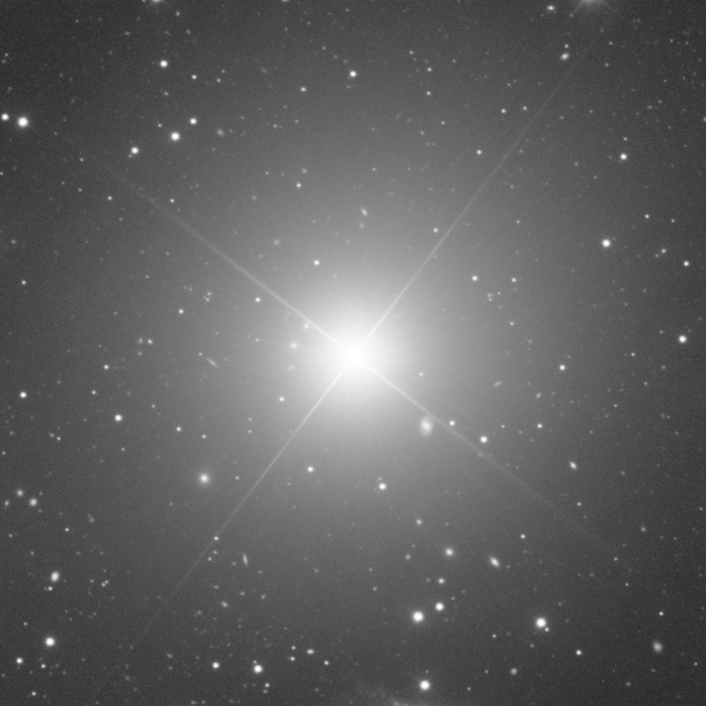
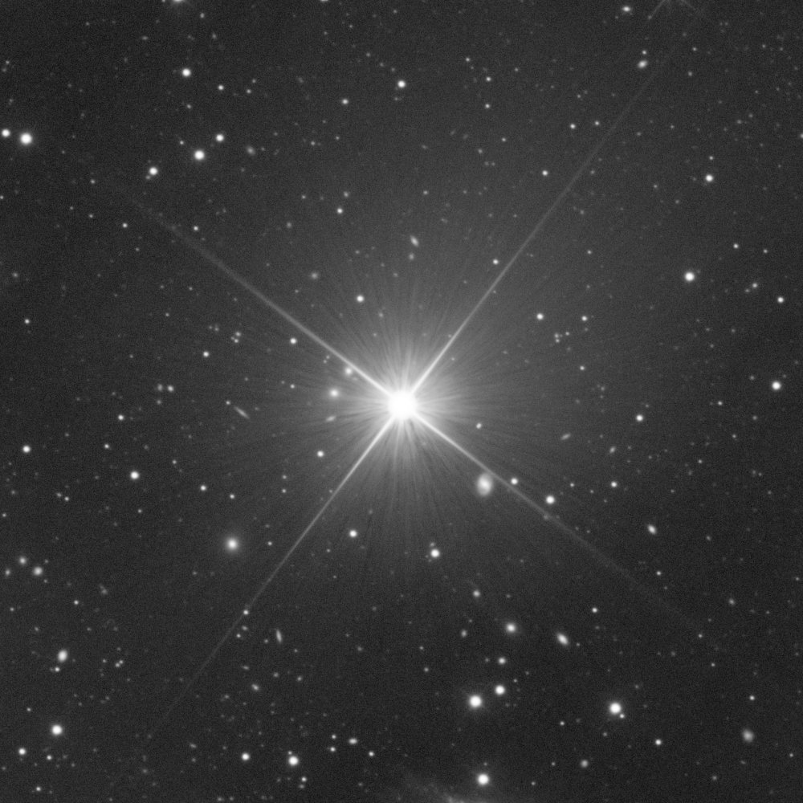

# Dehalo

Dehalo removes the wide, diffuse halos around bright stars in linear astronomical images.

## Where halos come from

A bright star has a halo of scattered light that can extend over thousands of pixels. The light is scattered in
the optics (mirror and lens surfaces, dust, coatings), reflected between filters, the sensor window and the sensor,
and scattered in the atmosphere by aerosols and thin clouds. When many subframes are stacked, this light adds up in
the master like a real part of the image.

The halo covers faint structures such as tidal tails, stellar streams and integrated flux nebula (IFN). Gradient
tools do not remove it well, because the halo is a steep radial structure, not a smooth gradient.

## What Dehalo does

1. It finds the stars with a saturated core (the halo stars).
2. It measures the azimuthal profile of each halo star: the median brightness in rings around the star. All stars
   and a sky plane are fitted together, so overlapping halos are separated.
3. It makes a smooth model of each halo and subtracts a part of it. Near the star a small part is removed, so the
   star keeps a natural glow; far from the star all of the halo can be removed.

The preview in the dialog updates while you change the settings. The result is calculated at full resolution
when you click **Apply**.


  
  
</img-comparison-slider>
<div class="cmp-labels"><span>Before</span><span>After</span></div>

*The brightest star in the M99 field, luminance. Data: Bernard Miller.*

## Where Dehalo goes in the workflow

```
calibration -> integration -> crop -> (gradient correction) -> DEHALO -> deconvolution -> stretch -> ...
```

- Use **linear** data only. The halo is additive only in linear data.
- A strong gradient can be corrected first with GradientCorrection. Its protection of bright structures keeps the
  halos. A gradient tool without such protection can take a part of the halo into its gradient model; then use
  Dehalo before that tool.
- Use Dehalo before deconvolution (for example BlurXTerminator). Deconvolution makes the residuals of any halo
  model sharper.
- The halo is not the same in different filters. Use Dehalo on each master (L, R, G, B), or on a linear RGB image,
  where each channel gets its own model.

## The tutorials

| Page | What you learn |
|---|---|
| [Quick start](quick-start.md) | One complete run on NGC 3310: detection, star selection, reduction, Apply, history. |
| [Preparing images](preparing-images.md) | Gradient correction, RGB composites, background neutralization, linked and unlinked preview stretch. |
| [Dialog reference](controls.md) | Every control, with typical values. Mouse and keyboard in the preview. |
| [Troubleshooting](troubleshooting.md) | No stars found, dark rings, too much or too little removed. |
| [NGC 3310](examples/ngc-3310.md) | Two very bright stars and six smaller ones, a large field-wide halo. |
| [M99](examples/m99.md) | A master that saturates below 1: set the Saturation. |
| [NGC 3077](examples/ngc-3077.md) | A small image with small star cores, and a galaxy mask. |
| [Arp 273](examples/arp-273.md) | A dense star field next to a galaxy pair. |
| [RCW 85](examples/rcw-85.md) | An RGB image with one very bright star. |
| [Sh2-82](examples/sh2-82.md) | An RGB image with a nebula inside the halo: exclusion mask. |

The full theory, the algorithms and the formulas are in the reference page that opens with the documentation
button in the dialog (see [Installation](../installation.md#3-install-the-documentation-optional)).
