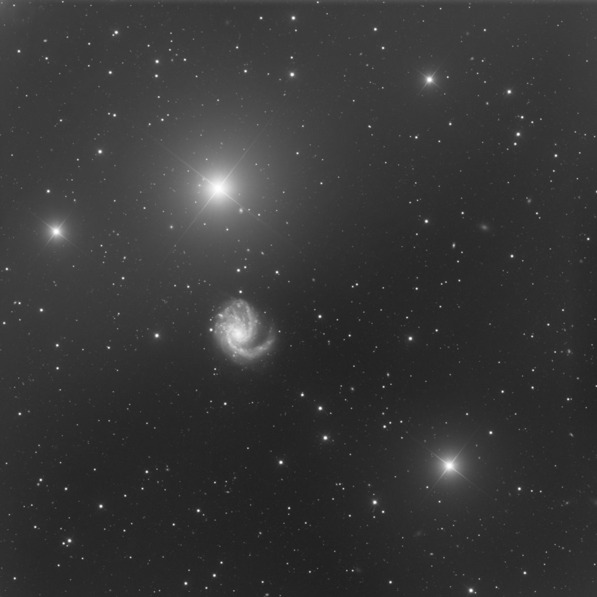
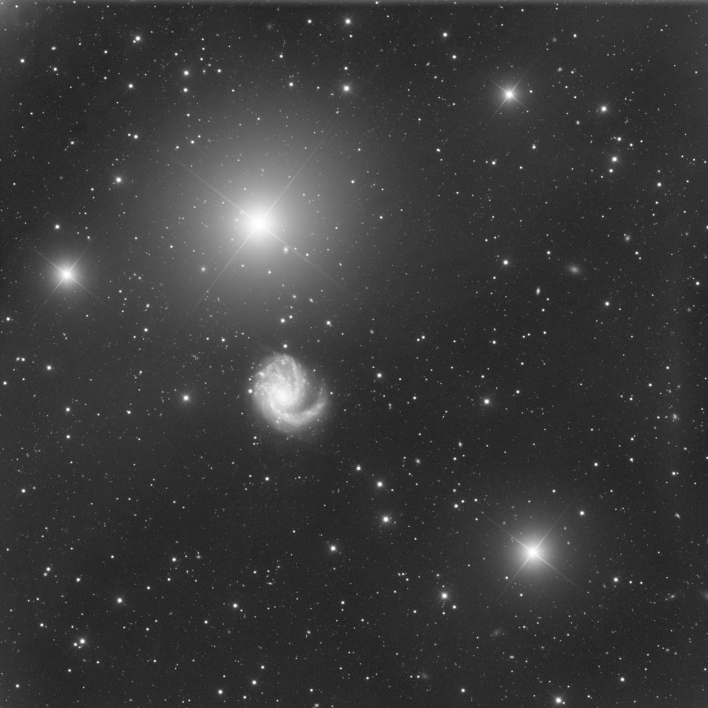
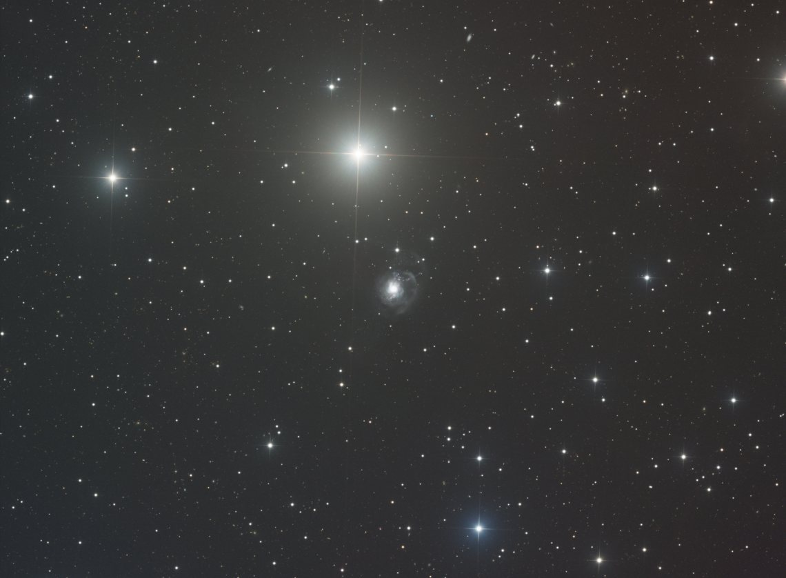
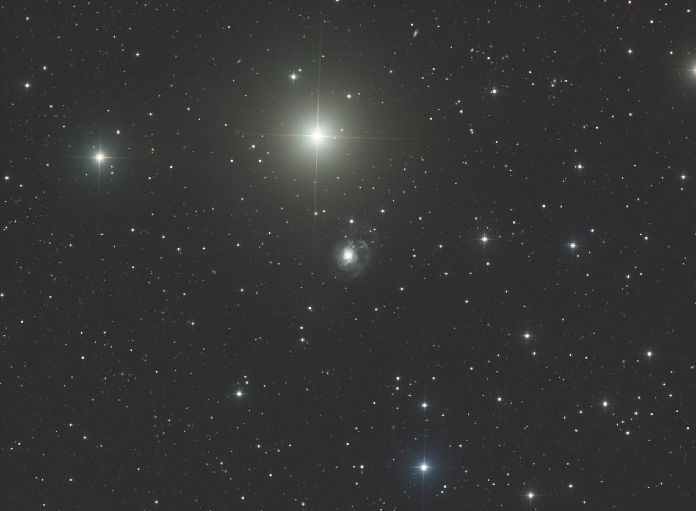
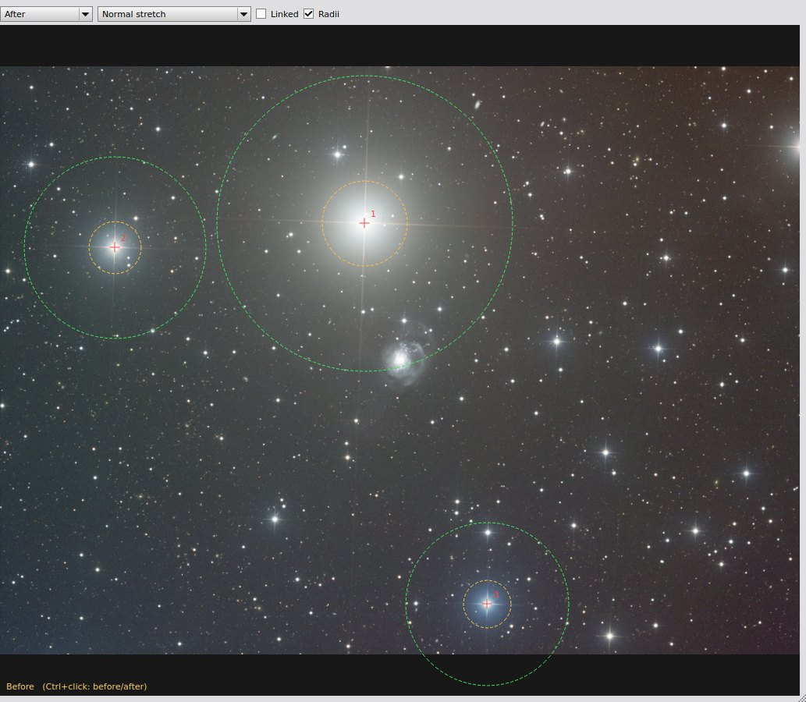
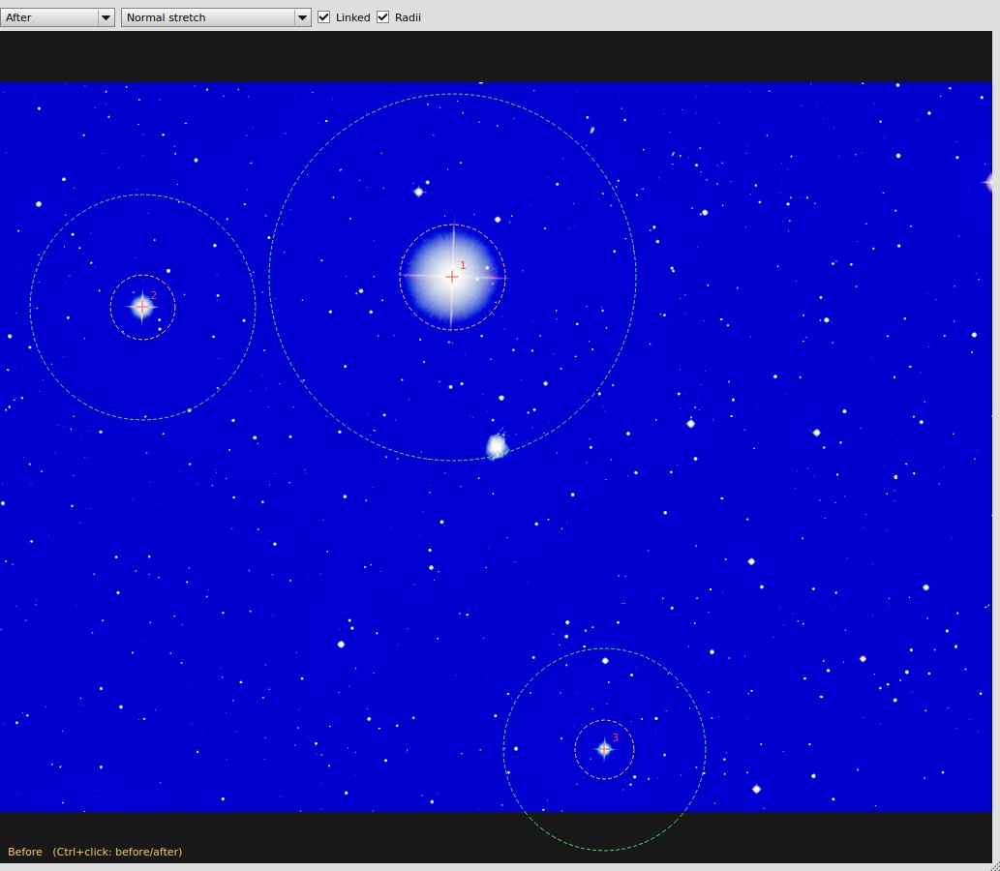

# Preparing images

Dehalo works on linear data: the masters after integration, or a linear RGB composite. This page shows the steps
that we used for all examples before Dehalo.

## Linear data

Do not stretch the image before Dehalo, and do not apply a HistogramTransformation. To see the image, use an STF auto
stretch (**Image > Screen Transfer Functions**); the STF changes only the display. The Dehalo preview has its own
stretch, so you can also look at the image only in the dialog.

Crop the stacking edges (the borders where not all subframes overlap) before Dehalo. Bad borders change the sky
plane of the fit.

## Gradient correction

Light pollution, the moon and vignetting residuals make large-scale gradients. Dehalo fits a sky plane (a linear
gradient) together with the halos, but a strong non-linear gradient makes the halo profiles wrong. Run
**GradientCorrection** first. We used its default parameters for all examples.

GradientCorrection protects bright structures by default (**Protection**), so it does not take the star halos into
its gradient model. In the M99 master below, the halo of the bright star is easier to see after the correction,
because the gradient around it is gone.

  
  
</img-comparison-slider>

MasterAfter GradientCorrection

!!! warning
    A gradient tool without protection of bright structures can take a part of the halo into its model. If you use
    such a tool, run Dehalo before it.

## RGB composites

You can use Dehalo on each colour master (R, G, B) or on an RGB composite. In a composite, each channel gets its own
halo model, because the halo is not the same in different filters. The examples RCW 85 and Sh2-82 use a composite:

1. Run GradientCorrection on each of the R, G and B masters.
2. Open **ChannelCombination** (**Process > ChannelManagement > ChannelCombination**). Select the RGB colour space,
   enter the R, G and B masters, and apply it (the global apply button) to make a new RGB image.
3. Run **BackgroundNeutralization** on the composite (default parameters, or a background preview as the
   reference). This makes the background level the same in the three channels.

  
  
</img-comparison-slider>

Composite of the masters (unlinked stretch)GradientCorrection + BackgroundNeutralization (linked stretch)

*NGC 3310, RGB composite. The masters have a red gradient on the right side. Data: Dark Matters Astro.*

Colour calibration (for example SPCC) is not necessary before Dehalo. Each channel gets its own halo model, so you
can calibrate the colour after Dehalo.

## Linked and unlinked preview stretch

The **Linked** check box above the Dehalo preview selects how a colour image is stretched for the display:

- **Unticked (default)**: each channel is stretched on its own. The background is neutral even before
  background neutralization, but the colour balance of the stars and nebulae is not true.
- **Ticked**: one stretch for all channels. The display keeps the colour balance of the data. Before background
  neutralization, the channel with the highest background dominates.

The images below show the same raw composite of NGC 3310 (before BackgroundNeutralization) in the Dehalo preview.
With a linked stretch, the blue background dominates. After BackgroundNeutralization, the linked stretch looks
normal; this is how the RGB example images are shown.

*Left: unlinked. Right: linked, before BackgroundNeutralization.*

The stretch changes only the preview. It has no effect on the fit or on the result.
