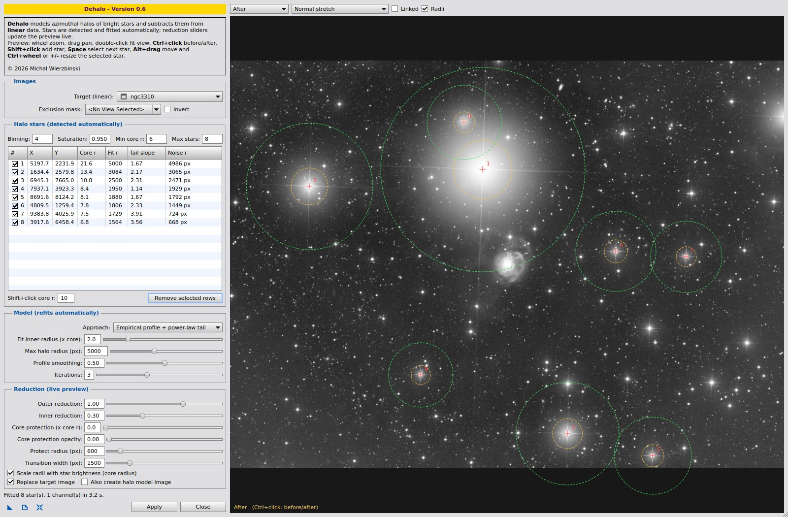
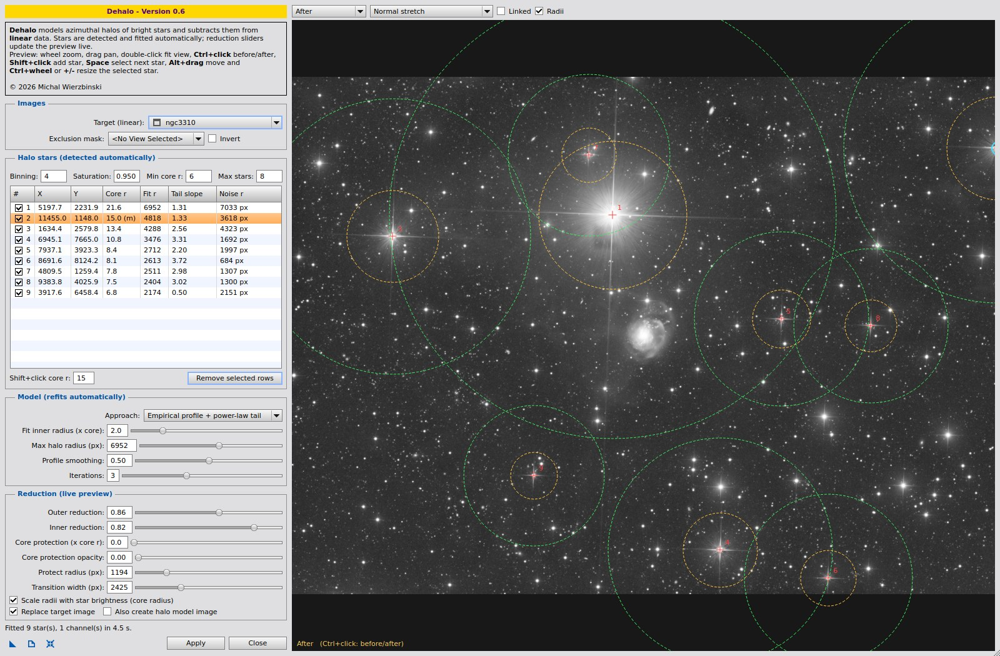
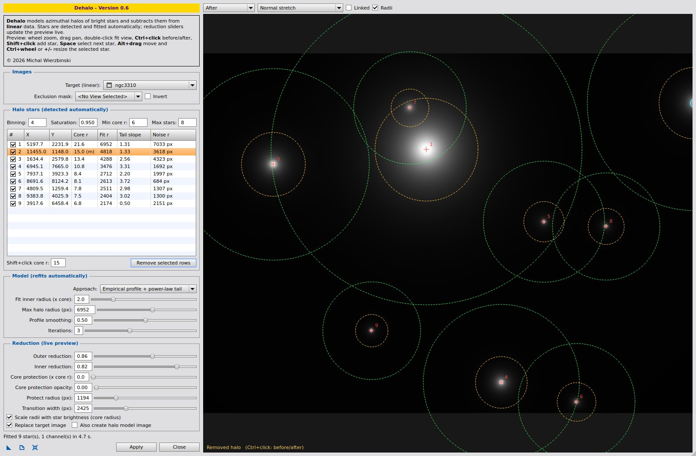
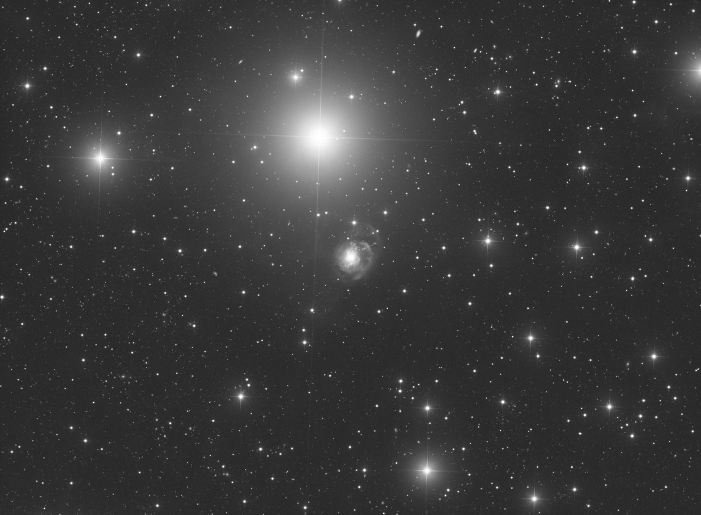
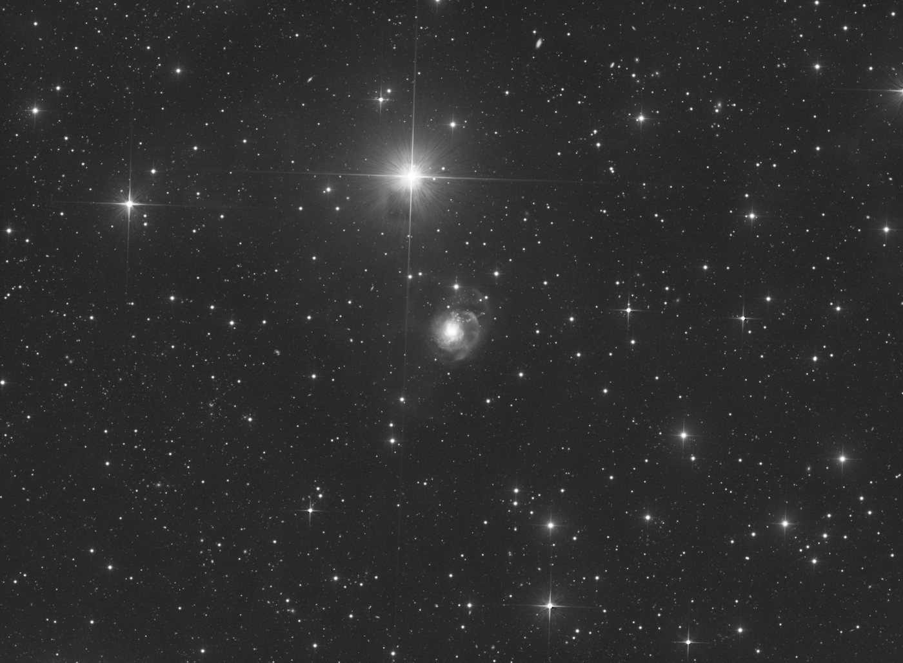

# Quick start

This tutorial makes one complete Dehalo run on the luminance master of NGC 3310. Two bright stars are next to the
galaxy: HD 92095 (the brightest) and a second star to its left in the image. Their halos cover a large part of the
field, six smaller stars add their own halos, and one more bright star is just outside the right edge of the
frame. We reduce the halos of all eight detected stars and add the star outside the frame by hand.

Data: Dark Matters Astro, PlaneWave CDK14 and Moravian C5A-100M, 0.31"/px, 11405 &times; 8388 px.

## 1. Prepare the image

1. Open the luminance master. It must be linear (not stretched). Use an STF auto stretch to look at it; the STF
   changes only the display.
2. Optional: run **GradientCorrection** with its default parameters. See
   [Preparing images](preparing-images.md#gradient-correction).

## 2. Start Dehalo

Make the image the active window and select **Script > Utilities > Dehalo**.

The script reads the image, finds the stars with a saturated core and fits their halos. You do not have to click a
button. After each change of a detection or model setting, the fit starts again after a short pause; the last result
stays on the screen until the new one is ready.

The preview (right) shows the image with circles around each halo star:

- the cross and the number: the star centre and its row in the star table;
- yellow circle: the **protect radius**, where the reduction starts to change from the inner to the outer value;
- green circle: the start of the full **outer reduction**;
- grey circle: a star that is unticked (its halo stays).

## 3. Select the stars

The star table lists the 8 detected stars, largest core first. For this tutorial, keep all of them ticked.

To keep the halo of a star in the image, untick it. An unticked star stays in the fit, so the models of the other
stars still take its light into account, but its own halo is not subtracted. Use **Remove selected rows** only for
false detections.

!!! tip
    To select a star in the preview, move the mouse over the preview and press ++space++. The selected star gets a
    cyan circle and its row is selected in the table.

### Add the star outside the frame

At the top of the right edge, a halo and a horizontal diffraction spike come into the image from a star just
outside the frame. Detection finds only saturated cores in the image, so this star is not in the table. Add it by
hand:

1. Set **Shift+click core r** (below the star table) to **15**. This gives the star a size scale between the two
   brightest stars.
2. Move the mouse over the preview and zoom out with the mouse wheel until there is space to the right of the image.
3. ++shift++ + click to the right of the image at **x 11455, y 1148**. The cursor position is shown above the
   preview, on the right. The new star is marked *(m)* in the table and is selected.
4. If the position is not exact, move the star with ++alt++ + drag. Change its core radius with ++plus++ /
   ++minus++.

The position comes from the halo: the halo at the edge is brightest at y = 1148, where the spike enters the image,
and its decrease into the image puts the centre about 50 px outside the edge. Only the pixels inside the image are
used for the profile of this star.

## 4. Set the model

| Control | Value | Why |
|---|---|---|
| Binning | 4 | Default. The fit and the preview use 4 &times; 4 binned pixels, so they are fast. |
| Saturation | 0.95 | Default. This master saturates at 1.0. |
| Min core r | 6 | Default. |
| Max stars | 8 | Default. |
| Approach | Empirical profile + power-law tail | Default. Follows the measured profile. |
| Fit inner radius (x core) | 2.0 | Default. |
| Max halo radius (px) | 6952 | The halo of HD 92095 reaches far into the field. |
| Profile smoothing | 0.50 | Default. |
| Iterations | 3 | Default. |

## 5. Set the reduction

The reduction settings do not start a new fit. The preview changes immediately.

| Control | Value | Why |
|---|---|---|
| Outer reduction | 0.86 | Remove most of the halo far from the star. |
| Inner reduction | 0.82 | Also remove most of the halo near the star. |
| Core protection | 0 | Default (off). |
| Protect radius (px) | 1194 | The reduction changes from the inner to the outer value from here... |
| Transition width (px) | 2425 | ...over this distance. |
| Scale radii with star brightness | on | The second star gets smaller radii, in proportion to its core radius. |

## 6. Check the result in the preview

- ++ctrl++ + click in the preview switches between **Before** and **After**.
- The view list above the preview also has **Removed halo**: the part that will be subtracted. It must be smooth
  and must not contain the galaxy or other structures.
- **Hard stretch** shows the faint halo and the IFN. Use it to find over-subtraction (dark areas around the stars).

## 7. Apply

Click **Apply**. With **Replace target image** ticked (default), the script writes the result into the image at full
resolution. The image gets one **Dehalo** entry in its history. **Undo** restores the original image.

The history entry contains all the parameters of the run, including the star list and which stars were ticked.
Drag the entry from the History Explorer onto another image (for example the R, G and B masters of the same field)
to run Dehalo there with the same settings, without the dialog.

## Result

  
  
</img-comparison-slider>

BeforeAfter

The dark patch and the marks near the core of HD 92095 that become visible after Dehalo are most likely stacking
and normalization artifacts of the master. The bright halo hid them before. See the
[NGC 3310 example page](examples/ngc-3310.md) for the explanation, more images and the second star.
