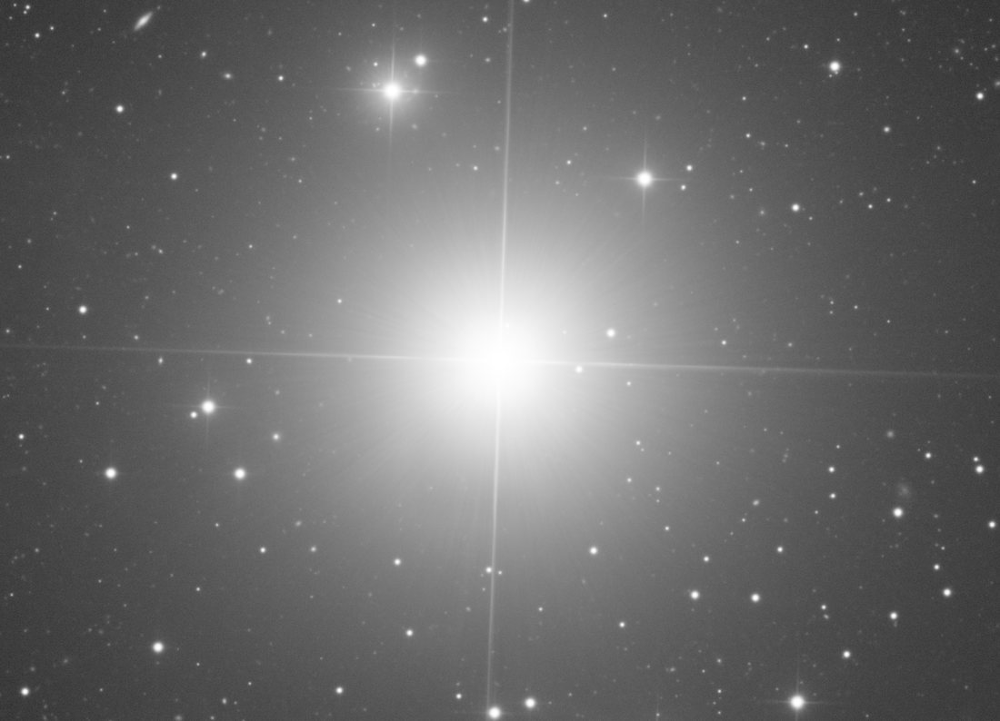
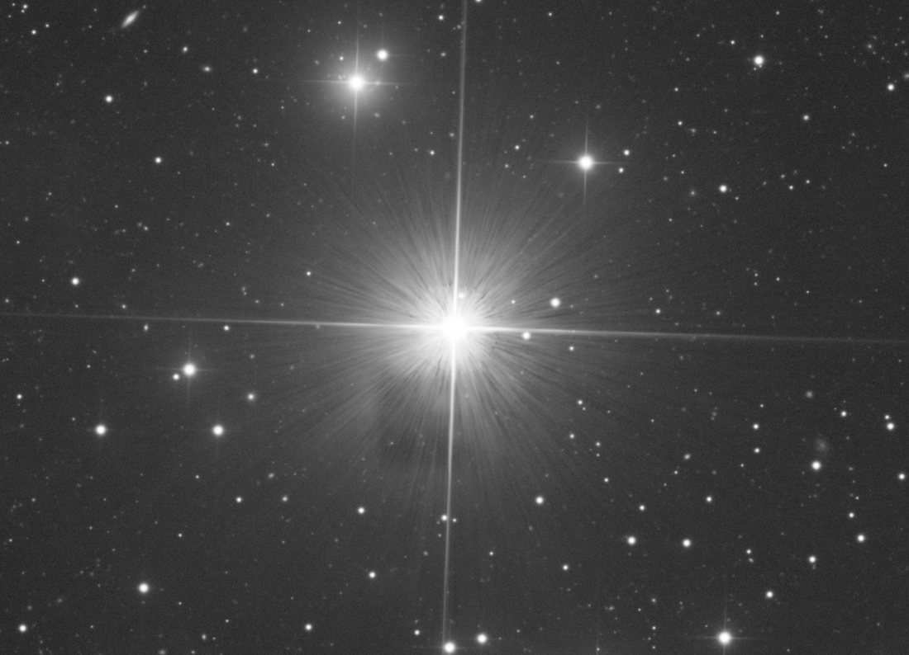

# mw-astro-pi-scripts

PixInsight scripts for astrophotography processing, with tutorials and worked examples.

| Script | Menu | What it does |
|---|---|---|
| [Dehalo](dehalo/index.md) | Script > Utilities > Dehalo | Models the wide halos of bright stars on linear images and subtracts them. |

## Start here

1. [Installation](installation.md): get the scripts and add them to PixInsight.
2. [Dehalo quick start](dehalo/quick-start.md): one complete run on NGC 3310, step by step.
3. [Dialog reference](dehalo/controls.md): what every control does and when to change it.
4. Examples: six real datasets, luminance and RGB, with the settings and before/after results.

  
  
</img-comparison-slider>

BeforeAfter

*HD 92095 next to NGC 3310, luminance master. Drag the slider to compare.*

## Source and licence

The code is on [GitHub](https://github.com/xultaeculcis/mw-astro-pi-scripts) under the MIT License. The example images
belong to their authors; each example page names the source of the data.
